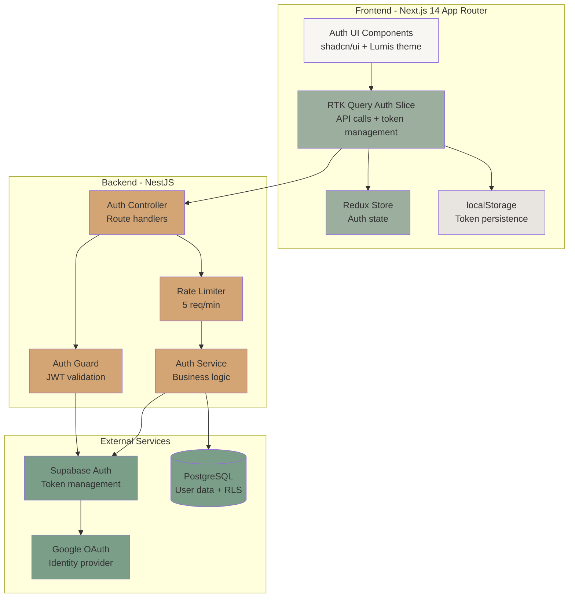
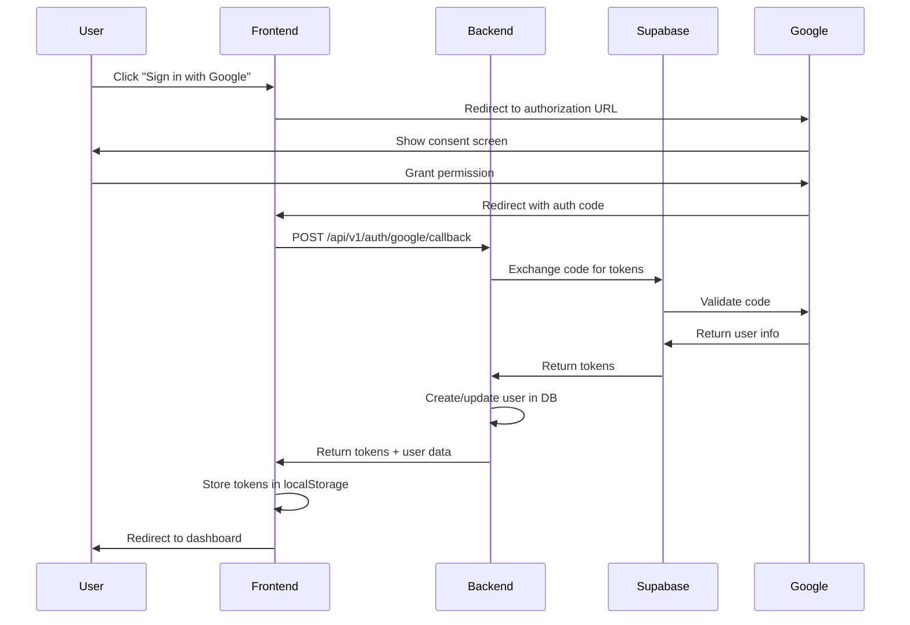
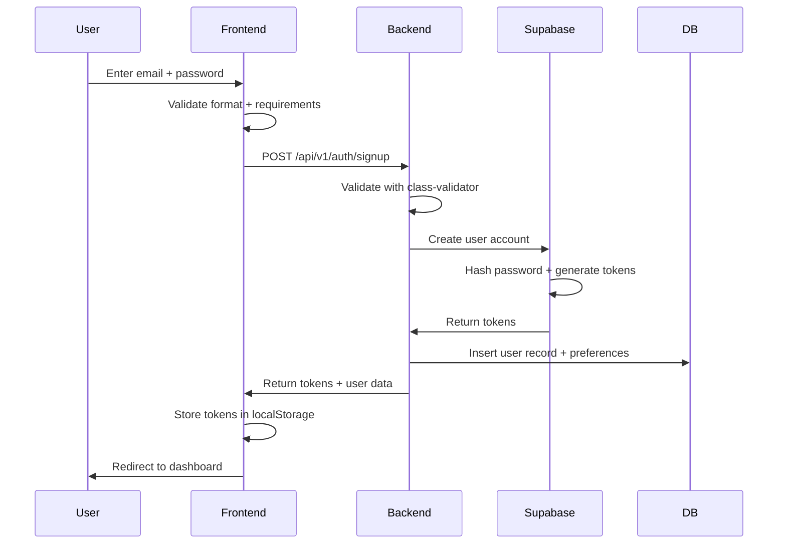
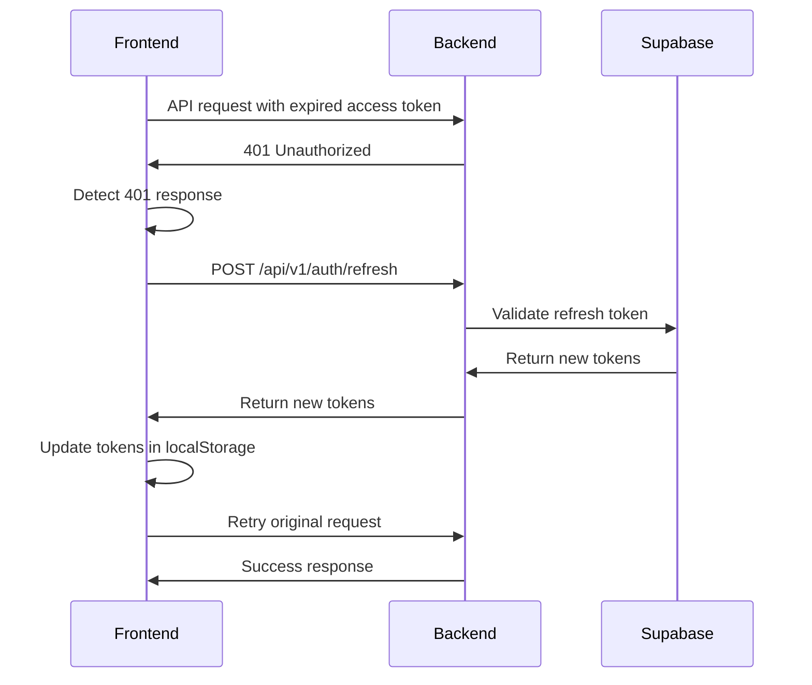

# Design Document: Authentication Flows

## Overview

The authentication system for Lumis provides secure user authentication through Google OAuth (Priority 1) and local email/password authentication (Priority 2 for sign up, Priority 3 for sign in). The system is built on a modern stack with Next.js 14 App Router frontend and NestJS backend, leveraging Supabase Auth for authentication services and PostgreSQL with row-level security for data persistence.

### Key Design Principles

- **Token-based authentication**: JWT tokens stored in browser localStorage with 15-minute access tokens and 7-day refresh tokens
- **Separation of concerns**: Clear boundaries between frontend state management (Redux Toolkit + RTK Query), backend API layer (NestJS), and authentication provider (Supabase Auth)
- **Security-first approach**: Rate limiting, input validation, HTTPS enforcement, and row-level security policies
- **Lumis design system integration**: Warm cream backgrounds, soft sage accents, Crimson Pro serif typography, and generous spacing
- **Graceful error handling**: User-friendly error messages with automatic token refresh on 401 responses

### Authentication Flows

1. **Google OAuth Flow**: User clicks Google sign in → redirects to Google → callback with authorization code → backend exchanges code for tokens → tokens stored in localStorage
2. **Local Sign Up Flow**: User submits email/password → frontend validates → backend creates account via Supabase → tokens returned and stored
3. **Local Sign In Flow**: User submits credentials → backend authenticates via Supabase → tokens returned and stored
4. **Token Refresh Flow**: Access token expires → RTK Query automatically sends refresh token → new tokens returned and stored
5. **Sign Out Flow**: User initiates sign out → backend invalidates session → tokens cleared from localStorage → redirect to sign in

## Architecture

### System Components



### Data Flow Diagrams

#### Google OAuth Flow



#### Local Sign Up Flow



#### Token Refresh Flow



### Technology Stack

**Frontend**
- Next.js 14 with App Router
- React 18 with TypeScript
- Redux Toolkit for state management
- RTK Query for API calls and caching
- shadcn/ui component library
- Tailwind CSS with Lumis theme tokens
- Zod for client-side validation

**Backend**
- NestJS framework with TypeScript
- class-validator and class-transformer for DTOs
- @nestjs/throttler for rate limiting
- @nestjs/passport and @nestjs/jwt for authentication
- Supabase JS client for auth operations

**Database & Auth**
- PostgreSQL (via Supabase)
- Row-level security policies
- Supabase Auth service

## Components and Interfaces

### Frontend Components

#### 1. AuthLayout Component
```typescript
// app/(auth)/layout.tsx
interface AuthLayoutProps {
  children: React.ReactNode;
}

// Provides consistent layout for all auth pages
// - Warm cream background (#F8F6F3)
// - Centered card with soft shadow
// - Lumis branding
```

#### 2. GoogleSignInButton Component
```typescript
// components/auth/GoogleSignInButton.tsx
interface GoogleSignInButtonProps {
  onSuccess?: () => void;
  onError?: (error: string) => void;
}

// Handles Google OAuth initiation
// - Styled with Google branding + Lumis theme
// - Redirects to Google authorization URL
// - Includes loading state
```

#### 3. SignUpForm Component
```typescript
// components/auth/SignUpForm.tsx
interface SignUpFormProps {
  onSuccess?: () => void;
}

interface SignUpFormData {
  email: string;
  password: string;
  confirmPassword: string;
}

// Local sign up form with validation
// - Email format validation
// - Password requirements (8+ chars, uppercase, lowercase, number)
// - Confirm password matching
// - Real-time validation feedback
// - Uses shadcn/ui FormField components
```

#### 4. SignInForm Component
```typescript
// components/auth/SignInForm.tsx
interface SignInFormProps {
  onSuccess?: () => void;
}

interface SignInFormData {
  email: string;
  password: string;
}

// Local sign in form
// - Email and password inputs
// - Remember me option (optional)
// - Link to sign up page
// - Uses shadcn/ui FormField components
```

#### 5. AuthErrorDisplay Component
```typescript
// components/auth/AuthErrorDisplay.tsx
interface AuthErrorDisplayProps {
  error: string | null;
  onDismiss?: () => void;
}

// Displays authentication errors
// - Warm styling with soft sage accents
// - Crimson Pro serif font
// - Dismissible alert
// - Auto-dismiss after 5 seconds
```

### Redux Toolkit State Management

#### Auth Slice
```typescript
// store/slices/authSlice.ts
interface AuthState {
  user: User | null;
  isAuthenticated: boolean;
  isLoading: boolean;
  error: string | null;
}

interface User {
  id: string;
  email: string;
  name: string | null;
  avatar_url: string | null;
  provider: 'google' | 'local';
  analysis_depth_mode: 'full-spectrum' | 'quick-scan';
  created_at: string;
}

// Actions:
// - setUser(user: User)
// - clearUser()
// - setLoading(isLoading: boolean)
// - setError(error: string | null)
```

#### RTK Query Auth API Slice
```typescript
// store/api/authApi.ts
interface AuthTokens {
  auth_token: string;
  access_token: string;
  refresh_token: string;
}

interface AuthResponse {
  success: boolean;
  data: {
    user: User;
    tokens: AuthTokens;
  };
  meta: {
    timestamp: string;
    request_id: string;
  };
}

interface ErrorResponse {
  success: false;
  error: {
    code: string;
    message: string;
  };
  meta: {
    timestamp: string;
    request_id: string;
  };
}

// Endpoints:
// - googleCallback(code: string): AuthResponse
// - signUp(credentials: SignUpDto): AuthResponse
// - signIn(credentials: SignInDto): AuthResponse
// - refreshToken(refreshToken: string): AuthResponse
// - signOut(): void
// - validateToken(): User

// Base query with automatic token refresh on 401
```

### Backend Components

#### 1. Auth Controller
```typescript
// src/auth/auth.controller.ts
@Controller('api/v1/auth')
@UseGuards(ThrottlerGuard)
export class AuthController {
  @Post('google/callback')
  @Throttle(5, 60) // 5 requests per minute
  async googleCallback(@Body() dto: GoogleCallbackDto): Promise<AuthResponse>
  
  @Post('signup')
  @Throttle(5, 60)
  async signUp(@Body() dto: SignUpDto): Promise<AuthResponse>
  
  @Post('login')
  @Throttle(5, 60)
  async signIn(@Body() dto: SignInDto): Promise<AuthResponse>
  
  @Post('refresh')
  @Throttle(5, 60)
  async refreshToken(@Body() dto: RefreshTokenDto): Promise<AuthResponse>
  
  @Post('logout')
  @UseGuards(AuthGuard)
  async signOut(@Request() req): Promise<void>
  
  @Get('validate')
  @UseGuards(AuthGuard)
  async validateToken(@Request() req): Promise<User>
}
```

#### 2. Auth Service
```typescript
// src/auth/auth.service.ts
export class AuthService {
  constructor(
    private supabase: SupabaseClient,
    private usersService: UsersService
  ) {}
  
  async handleGoogleCallback(code: string): Promise<AuthResponse>
  async signUp(email: string, password: string): Promise<AuthResponse>
  async signIn(email: string, password: string): Promise<AuthResponse>
  async refreshToken(refreshToken: string): Promise<AuthResponse>
  async signOut(userId: string): Promise<void>
  async validateToken(token: string): Promise<User>
  
  private async createOrUpdateUser(supabaseUser: SupabaseUser): Promise<User>
  private async initializeUserPreferences(userId: string): Promise<void>
}
```

#### 3. Auth Guard
```typescript
// src/auth/guards/auth.guard.ts
@Injectable()
export class AuthGuard implements CanActivate {
  constructor(private supabase: SupabaseClient) {}
  
  async canActivate(context: ExecutionContext): Promise<boolean> {
    const request = context.switchToHttp().getRequest();
    const token = this.extractTokenFromHeader(request);
    
    if (!token) {
      throw new UnauthorizedException();
    }
    
    const user = await this.validateToken(token);
    request.user = user;
    return true;
  }
  
  private extractTokenFromHeader(request: Request): string | undefined
  private async validateToken(token: string): Promise<User>
}
```

#### 4. DTOs (Data Transfer Objects)
```typescript
// src/auth/dto/google-callback.dto.ts
export class GoogleCallbackDto {
  @IsString()
  @IsNotEmpty()
  code: string;
}

// src/auth/dto/sign-up.dto.ts
export class SignUpDto {
  @IsEmail()
  email: string;
  
  @IsString()
  @MinLength(8)
  @Matches(/^(?=.*[a-z])(?=.*[A-Z])(?=.*\d)/, {
    message: 'Password must contain uppercase, lowercase, and number'
  })
  password: string;
}

// src/auth/dto/sign-in.dto.ts
export class SignInDto {
  @IsEmail()
  email: string;
  
  @IsString()
  @IsNotEmpty()
  password: string;
}

// src/auth/dto/refresh-token.dto.ts
export class RefreshTokenDto {
  @IsString()
  @IsNotEmpty()
  refresh_token: string;
}
```

### API Endpoints

#### POST /api/v1/auth/google/callback
**Purpose**: Exchange Google authorization code for authentication tokens

**Request**:
```json
{
  "code": "4/0AY0e-g7X..."
}
```

**Success Response (200)**:
```json
{
  "success": true,
  "data": {
    "user": {
      "id": "uuid",
      "email": "user@example.com",
      "name": "John Doe",
      "avatar_url": "https://...",
      "provider": "google",
      "analysis_depth_mode": "full-spectrum",
      "created_at": "2024-01-15T10:30:00Z"
    },
    "tokens": {
      "auth_token": "eyJhbGc...",
      "access_token": "eyJhbGc...",
      "refresh_token": "eyJhbGc..."
    }
  },
  "meta": {
    "timestamp": "2024-01-15T10:30:00Z",
    "request_id": "req_123"
  }
}
```

**Error Response (401)**:
```json
{
  "success": false,
  "error": {
    "code": "INVALID_AUTH_CODE",
    "message": "The authorization code is invalid or expired"
  },
  "meta": {
    "timestamp": "2024-01-15T10:30:00Z",
    "request_id": "req_123"
  }
}
```

**Rate Limit**: 5 requests per minute per client

---

#### POST /api/v1/auth/signup
**Purpose**: Create new user account with email and password

**Request**:
```json
{
  "email": "user@example.com",
  "password": "SecurePass123"
}
```

**Success Response (201)**:
```json
{
  "success": true,
  "data": {
    "user": {
      "id": "uuid",
      "email": "user@example.com",
      "name": null,
      "avatar_url": null,
      "provider": "local",
      "analysis_depth_mode": "full-spectrum",
      "created_at": "2024-01-15T10:30:00Z"
    },
    "tokens": {
      "auth_token": "eyJhbGc...",
      "access_token": "eyJhbGc...",
      "refresh_token": "eyJhbGc..."
    }
  },
  "meta": {
    "timestamp": "2024-01-15T10:30:00Z",
    "request_id": "req_124"
  }
}
```

**Error Response (409 - Email exists)**:
```json
{
  "success": false,
  "error": {
    "code": "EMAIL_ALREADY_EXISTS",
    "message": "An account with this email already exists"
  },
  "meta": {
    "timestamp": "2024-01-15T10:30:00Z",
    "request_id": "req_124"
  }
}
```

**Error Response (400 - Validation failed)**:
```json
{
  "success": false,
  "error": {
    "code": "VALIDATION_ERROR",
    "message": "Password must contain uppercase, lowercase, and number"
  },
  "meta": {
    "timestamp": "2024-01-15T10:30:00Z",
    "request_id": "req_124"
  }
}
```

**Rate Limit**: 5 requests per minute per client

---

#### POST /api/v1/auth/login
**Purpose**: Authenticate user with email and password

**Request**:
```json
{
  "email": "user@example.com",
  "password": "SecurePass123"
}
```

**Success Response (200)**:
```json
{
  "success": true,
  "data": {
    "user": {
      "id": "uuid",
      "email": "user@example.com",
      "name": "John Doe",
      "avatar_url": null,
      "provider": "local",
      "analysis_depth_mode": "full-spectrum",
      "created_at": "2024-01-15T10:30:00Z"
    },
    "tokens": {
      "auth_token": "eyJhbGc...",
      "access_token": "eyJhbGc...",
      "refresh_token": "eyJhbGc..."
    }
  },
  "meta": {
    "timestamp": "2024-01-15T10:30:00Z",
    "request_id": "req_125"
  }
}
```

**Error Response (401)**:
```json
{
  "success": false,
  "error": {
    "code": "INVALID_CREDENTIALS",
    "message": "Invalid email or password"
  },
  "meta": {
    "timestamp": "2024-01-15T10:30:00Z",
    "request_id": "req_125"
  }
}
```

**Rate Limit**: 5 requests per minute per client

---

#### POST /api/v1/auth/refresh
**Purpose**: Obtain new access token using refresh token

**Request**:
```json
{
  "refresh_token": "eyJhbGc..."
}
```

**Success Response (200)**:
```json
{
  "success": true,
  "data": {
    "user": {
      "id": "uuid",
      "email": "user@example.com",
      "name": "John Doe",
      "avatar_url": null,
      "provider": "local",
      "analysis_depth_mode": "full-spectrum",
      "created_at": "2024-01-15T10:30:00Z"
    },
    "tokens": {
      "auth_token": "eyJhbGc...",
      "access_token": "eyJhbGc...",
      "refresh_token": "eyJhbGc..."
    }
  },
  "meta": {
    "timestamp": "2024-01-15T10:30:00Z",
    "request_id": "req_126"
  }
}
```

**Error Response (401)**:
```json
{
  "success": false,
  "error": {
    "code": "INVALID_REFRESH_TOKEN",
    "message": "The refresh token is invalid or expired"
  },
  "meta": {
    "timestamp": "2024-01-15T10:30:00Z",
    "request_id": "req_126"
  }
}
```

**Rate Limit**: 5 requests per minute per client

---

#### POST /api/v1/auth/logout
**Purpose**: Invalidate user session and tokens

**Headers**:
```
Authorization: Bearer <access_token>
```

**Success Response (204)**: No content

**Error Response (401)**:
```json
{
  "success": false,
  "error": {
    "code": "UNAUTHORIZED",
    "message": "Invalid or expired token"
  },
  "meta": {
    "timestamp": "2024-01-15T10:30:00Z",
    "request_id": "req_127"
  }
}
```

---

#### GET /api/v1/auth/validate
**Purpose**: Validate current access token and return user data

**Headers**:
```
Authorization: Bearer <access_token>
```

**Success Response (200)**:
```json
{
  "success": true,
  "data": {
    "user": {
      "id": "uuid",
      "email": "user@example.com",
      "name": "John Doe",
      "avatar_url": null,
      "provider": "local",
      "analysis_depth_mode": "full-spectrum",
      "created_at": "2024-01-15T10:30:00Z"
    }
  },
  "meta": {
    "timestamp": "2024-01-15T10:30:00Z",
    "request_id": "req_128"
  }
}
```

**Error Response (401)**:
```json
{
  "success": false,
  "error": {
    "code": "UNAUTHORIZED",
    "message": "Invalid or expired token"
  },
  "meta": {
    "timestamp": "2024-01-15T10:30:00Z",
    "request_id": "req_128"
  }
}
```

## Data Models

### Database Schema

#### users Table
```sql
CREATE TABLE users (
  id UUID PRIMARY KEY DEFAULT uuid_generate_v4(),
  email VARCHAR(255) UNIQUE NOT NULL,
  name VARCHAR(255),
  avatar_url TEXT,
  provider VARCHAR(20) NOT NULL CHECK (provider IN ('google', 'local')),
  analysis_depth_mode VARCHAR(20) NOT NULL DEFAULT 'full-spectrum' 
    CHECK (analysis_depth_mode IN ('full-spectrum', 'quick-scan')),
  created_at TIMESTAMP WITH TIME ZONE DEFAULT NOW(),
  updated_at TIMESTAMP WITH TIME ZONE DEFAULT NOW(),
  deleted_at TIMESTAMP WITH TIME ZONE
);

-- Indexes
CREATE INDEX idx_users_email ON users(email) WHERE deleted_at IS NULL;
CREATE INDEX idx_users_provider ON users(provider);

-- Row-Level Security Policies
ALTER TABLE users ENABLE ROW LEVEL SECURITY;

-- Policy: Users can only read their own data
CREATE POLICY users_select_own 
  ON users FOR SELECT 
  USING (auth.uid() = id);

-- Policy: Users can only update their own data
CREATE POLICY users_update_own 
  ON users FOR UPDATE 
  USING (auth.uid() = id);

-- Policy: Service role can insert users (for signup)
CREATE POLICY users_insert_service 
  ON users FOR INSERT 
  WITH CHECK (true);

-- Trigger to update updated_at timestamp
CREATE OR REPLACE FUNCTION update_updated_at_column()
RETURNS TRIGGER AS $$
BEGIN
  NEW.updated_at = NOW();
  RETURN NEW;
END;
$$ LANGUAGE plpgsql;

CREATE TRIGGER update_users_updated_at 
  BEFORE UPDATE ON users
  FOR EACH ROW
  EXECUTE FUNCTION update_updated_at_column();
```

### TypeScript Interfaces

#### User Entity
```typescript
// Shared between frontend and backend
export interface User {
  id: string;
  email: string;
  name: string | null;
  avatar_url: string | null;
  provider: 'google' | 'local';
  analysis_depth_mode: 'full-spectrum' | 'quick-scan';
  created_at: string;
  updated_at: string;
  deleted_at: string | null;
}
```

#### Token Storage Structure
```typescript
// localStorage keys and structure
const TOKEN_KEYS = {
  AUTH_TOKEN: 'lumis_auth_token',
  ACCESS_TOKEN: 'lumis_access_token',
  REFRESH_TOKEN: 'lumis_refresh_token',
} as const;

interface StoredTokens {
  auth_token: string;
  access_token: string;
  refresh_token: string;
  expires_at: number; // Unix timestamp
}
```

### State Management Models

#### Redux Auth State
```typescript
interface AuthState {
  user: User | null;
  isAuthenticated: boolean;
  isLoading: boolean;
  error: string | null;
  lastTokenRefresh: number | null; // Unix timestamp
}
```

#### RTK Query Cache Structure
```typescript
// Cached by endpoint
interface AuthApiCache {
  'auth/validate': {
    data: User;
    timestamp: number;
  };
  'auth/signIn': {
    data: AuthResponse;
    timestamp: number;
  };
  // ... other endpoints
}
```


## Correctness Properties

*A property is a characteristic or behavior that should hold true across all valid executions of a system—essentially, a formal statement about what the system should do. Properties serve as the bridge between human-readable specifications and machine-verifiable correctness guarantees.*

### Property 1: Google OAuth callback API invocation

*For any* authorization code received from Google's OAuth callback, the Frontend_Client should send that code to the Backend_API at /api/v1/auth/google/callback.

**Validates: Requirements 1.2**

### Property 2: Backend token exchange for valid OAuth codes

*For any* valid authorization code received by the Backend_API, the system should exchange it with Supabase_Auth and return a response containing all three tokens (auth_token, access_token, refresh_token).

**Validates: Requirements 1.3, 1.4**

### Property 3: Token storage completeness

*For any* set of authentication tokens (auth_token, access_token, refresh_token) received by the Frontend_Client from any authentication flow, all three tokens should be stored in localStorage as separate entries.

**Validates: Requirements 1.5, 2.7, 3.5, 4.1**

### Property 4: New user preference initialization

*For any* new user created through either Google OAuth or local sign up, the Backend_API should initialize User_Preferences with analysis_depth_mode set to 'full-spectrum'.

**Validates: Requirements 1.6, 2.5, 11.5**

### Property 5: Rate limiting enforcement

*For any* sequence of requests to authentication endpoints (/auth/google/callback, /auth/signup, /auth/login, /auth/refresh) that exceeds 5 requests per minute from a single client, the Backend_API should reject subsequent requests with a 429 status code.

**Validates: Requirements 1.9, 2.11, 3.8, 5.8, 9.4**

### Property 6: Frontend credential validation

*For any* user credentials submitted for sign up, the Frontend_Client should validate that the email matches email format and the password contains at least 8 characters with at least one uppercase letter, one lowercase letter, and one number before sending to the backend.

**Validates: Requirements 2.1, 2.10**

### Property 7: Valid credentials trigger API call

*For any* valid user credentials on the frontend, the RTK_Auth_Slice should send those credentials to the appropriate Backend_API endpoint (/auth/signup for sign up, /auth/login for sign in).

**Validates: Requirements 2.2, 3.1**

### Property 8: Backend input validation

*For any* input data received by authentication endpoints, the Backend_API should validate all fields using class-validator DTOs to ensure type safety and prevent injection attacks.

**Validates: Requirements 2.3, 2.12, 3.2, 9.2**

### Property 9: User account creation

*For any* valid sign up credentials that pass validation, the Backend_API should create a new user account via Supabase_Auth and insert a corresponding record in the Users_Table.

**Validates: Requirements 2.4, 11.3**

### Property 10: Successful authentication response format

*For any* successful authentication operation (Google OAuth, sign up, sign in, token refresh), the Backend_API should return a response with success: true, a data object containing user information and all three tokens, and meta information including timestamp and request_id.

**Validates: Requirements 2.6, 3.4, 5.3**

### Property 11: PII exclusion from logs

*For any* log entry generated by the Backend_API, the log should not contain email addresses, passwords, or other personally identifiable information.

**Validates: Requirements 2.13, 3.9, 9.7**

### Property 12: User authentication via Supabase

*For any* valid sign in credentials received by the Backend_API, the system should attempt to authenticate the user via Supabase_Auth.

**Validates: Requirements 3.3**

### Property 13: Access token retrieval for requests

*For any* API request that requires authentication, the RTK_Auth_Slice should retrieve the Access_Token from localStorage and include it in the request.

**Validates: Requirements 4.2, 7.1**

### Property 14: Token validation on initialization

*For any* existing tokens found in localStorage when the Frontend_Client initializes, the RTK_Auth_Slice should validate those tokens with the Backend_API.

**Validates: Requirements 4.4**

### Property 15: Exclusive localStorage token storage

*For any* token storage operation in the Auth_System, tokens should be stored exclusively in localStorage and never in httpOnly cookies or environment variables.

**Validates: Requirements 4.5, 4.6, 4.7**

### Property 16: Automatic token refresh on expiration

*For any* expired Access_Token, the RTK_Auth_Slice should automatically send the Refresh_Token to the Backend_API at /api/v1/auth/refresh to obtain new tokens.

**Validates: Requirements 5.1**

### Property 17: Backend token refresh processing

*For any* valid Refresh_Token received by the Backend_API, the system should request new tokens from Supabase_Auth and return them in the standard response format.

**Validates: Requirements 5.2**

### Property 18: Token update after refresh

*For any* new tokens received from a successful refresh operation, the RTK_Auth_Slice should update all three tokens in localStorage.

**Validates: Requirements 5.4**

### Property 19: Automatic retry with token refresh on 401

*For any* 401 Unauthorized response received from any API endpoint, the RTK_Auth_Slice should automatically attempt token refresh and retry the original request with the new access token.

**Validates: Requirements 5.7, 7.5**

### Property 20: Sign out API invocation

*For any* user-initiated sign out action, the RTK_Auth_Slice should send a sign out request to the Backend_API at /api/v1/auth/logout with the current Auth_Token.

**Validates: Requirements 6.1**

### Property 21: Session invalidation on sign out

*For any* sign out request received by the Backend_API, the system should invalidate the user's session via Supabase_Auth.

**Validates: Requirements 6.2**

### Property 22: Token cleanup on sign out

*For any* successful session invalidation, the RTK_Auth_Slice should remove all tokens from localStorage and redirect the user to the sign in page.

**Validates: Requirements 6.3, 6.4**

### Property 23: Backend token validation

*For any* API request received by the Backend_API with an Authorization header, the system should validate the Access_Token with Supabase_Auth before processing the request.

**Validates: Requirements 7.2**

### Property 24: Request processing for valid tokens

*For any* API request with a valid Access_Token, the Backend_API should process the request and return the appropriate response.

**Validates: Requirements 7.3**

### Property 25: Row-level security enforcement

*For any* database query to the Users_Table, the Backend_API should enforce row-level security policies to ensure users can only access their own data.

**Validates: Requirements 7.6, 9.9, 11.2**

### Property 26: Error message display

*For any* authentication error that occurs, the Frontend_Client should display a user-friendly error message to the user.

**Validates: Requirements 8.1**

### Property 27: Field-specific validation errors

*For any* validation failure on the Frontend_Client, the system should display field-specific error messages indicating which fields failed validation and why.

**Validates: Requirements 8.3**

### Property 28: Structured error response format

*For any* error response from the Backend_API, the response should follow the standard format with success: false, an error object containing code and message, and meta information.

**Validates: Requirements 8.4**

### Property 29: HTTPS enforcement in production

*For any* request to the Backend_API while in production environment, the system should only accept HTTPS connections and reject HTTP requests.

**Validates: Requirements 9.1, 9.8**

### Property 30: Form data cleanup after submission

*For any* authentication form submission on the Frontend_Client, the system should clear sensitive form data from memory after the submission completes.

**Validates: Requirements 9.3**

### Property 31: Token storage without encryption

*For any* token storage operation, the RTK_Auth_Slice should store tokens in localStorage without applying additional encryption.

**Validates: Requirements 9.5**

### Property 32: CORS restriction enforcement

*For any* request to the Backend_API from an origin other than the authorized frontend URL, the system should reject the request based on CORS headers.

**Validates: Requirements 9.6**

### Property 33: Soft delete for user accounts

*For any* user account deletion operation, the Backend_API should perform a soft delete by setting the deleted_at timestamp in the Users_Table rather than permanently removing the record.

**Validates: Requirements 11.1**

### Property 34: Google OAuth user record update

*For any* Google OAuth sign in where the email already exists in the Users_Table, the Backend_API should update the existing user record rather than creating a duplicate.

**Validates: Requirements 11.4**

## Error Handling

### Frontend Error Handling

#### Validation Errors
- **Email format errors**: Display "Please enter a valid email address" below the email field
- **Password requirement errors**: Display specific messages for each unmet requirement:
  - "Password must be at least 8 characters"
  - "Password must contain at least one uppercase letter"
  - "Password must contain at least one lowercase letter"
  - "Password must contain at least one number"
- **Password mismatch**: Display "Passwords do not match" below the confirm password field

#### Authentication Errors
- **Invalid credentials (401)**: Display "Invalid email or password. Please try again."
- **Email already exists (409)**: Display "An account with this email already exists. Please sign in instead."
- **Google OAuth failure**: Display "Unable to sign in with Google. Please try again or use email/password."
- **Network errors**: Display "Unable to connect. Please check your internet connection and try again."
- **Rate limit exceeded (429)**: Display "Too many attempts. Please wait a moment and try again."

#### Token Errors
- **Expired access token**: Automatically attempt refresh (transparent to user)
- **Invalid refresh token**: Clear tokens, redirect to sign in, display "Your session has expired. Please sign in again."
- **Token refresh failure**: Clear tokens, redirect to sign in, display "Your session has expired. Please sign in again."

#### Error Display Component Behavior
- Errors appear in a dismissible alert component with warm cream background and soft sage border
- Errors auto-dismiss after 5 seconds unless user dismisses manually
- Field-specific errors appear below the relevant input field
- General errors appear at the top of the form
- All error text uses Crimson Pro serif font

### Backend Error Handling

#### Error Response Structure
All error responses follow this format:
```typescript
{
  success: false,
  error: {
    code: string,        // Machine-readable error code
    message: string      // Human-readable error message
  },
  meta: {
    timestamp: string,   // ISO 8601 timestamp
    request_id: string   // Unique request identifier for debugging
  }
}
```

#### Error Codes and HTTP Status Codes

| Error Code | HTTP Status | Description | User Message |
|------------|-------------|-------------|--------------|
| INVALID_AUTH_CODE | 401 | Google OAuth code is invalid or expired | Unable to complete Google sign in |
| INVALID_CREDENTIALS | 401 | Email or password is incorrect | Invalid email or password |
| EMAIL_ALREADY_EXISTS | 409 | Email is already registered | An account with this email already exists |
| VALIDATION_ERROR | 400 | Input validation failed | Please check your input and try again |
| INVALID_REFRESH_TOKEN | 401 | Refresh token is invalid or expired | Your session has expired |
| UNAUTHORIZED | 401 | Access token is invalid or missing | Please sign in to continue |
| RATE_LIMIT_EXCEEDED | 429 | Too many requests | Too many attempts, please try again later |
| INTERNAL_ERROR | 500 | Unexpected server error | Something went wrong, please try again |

#### Error Logging Strategy
- **Log Level: ERROR** - All authentication failures, validation errors, and unexpected exceptions
- **Log Level: WARN** - Rate limit violations, suspicious activity patterns
- **Log Level: INFO** - Successful authentication events (without PII)
- **PII Exclusion**: Never log email addresses, passwords, tokens, or other sensitive data
- **Error Context**: Include request_id, timestamp, error code, and sanitized error details
- **Structured Logging**: Use JSON format for easy parsing and analysis

#### Exception Handling
```typescript
try {
  // Authentication logic
} catch (error) {
  if (error instanceof SupabaseAuthError) {
    // Handle Supabase-specific errors
    return this.handleSupabaseError(error);
  } else if (error instanceof ValidationError) {
    // Handle validation errors
    return this.handleValidationError(error);
  } else {
    // Handle unexpected errors
    this.logger.error('Unexpected authentication error', {
      request_id: requestId,
      error: error.message,
      stack: error.stack
    });
    throw new InternalServerErrorException({
      success: false,
      error: {
        code: 'INTERNAL_ERROR',
        message: 'An unexpected error occurred'
      },
      meta: {
        timestamp: new Date().toISOString(),
        request_id: requestId
      }
    });
  }
}
```

#### Graceful Degradation
- **Supabase unavailable**: Return 503 Service Unavailable with retry-after header
- **Database connection lost**: Queue operations if possible, otherwise return 503
- **Google OAuth service down**: Display error and suggest using email/password authentication

### Error Recovery Strategies

#### Automatic Recovery
1. **Token Refresh**: Automatically retry failed requests after refreshing tokens
2. **Retry Logic**: Retry failed requests up to 3 times with exponential backoff for network errors
3. **Fallback Authentication**: If Google OAuth fails, suggest email/password sign in

#### Manual Recovery
1. **Session Expiration**: Clear state and redirect to sign in page
2. **Network Errors**: Display retry button for user to manually retry
3. **Validation Errors**: Allow user to correct input and resubmit

## Testing Strategy

### Overview

The authentication flows feature will be tested using a dual approach combining unit tests for specific examples and edge cases with property-based tests for universal correctness properties. This comprehensive strategy ensures both concrete functionality and general correctness across all possible inputs.

### Unit Testing

Unit tests will focus on:
- **Specific examples**: Testing concrete scenarios like "user signs up with valid email and password"
- **Edge cases**: Testing boundary conditions like empty inputs, malformed emails, rate limit thresholds
- **Error conditions**: Testing specific error scenarios like duplicate emails, invalid tokens
- **Integration points**: Testing interactions between components like Redux store updates, API calls

**Testing Framework**: Jest with React Testing Library for frontend, Jest for backend

**Frontend Unit Tests**:
- Component rendering and user interactions
- Form validation logic
- Redux action dispatchers and reducers
- RTK Query endpoint calls
- localStorage operations
- Error display components

**Backend Unit Tests**:
- Controller endpoint handlers
- Service method logic
- DTO validation
- Auth guard behavior
- Error response formatting
- Database operations (with mocked Supabase client)

**Example Unit Tests**:
```typescript
// Frontend: Sign up form validation
describe('SignUpForm validation', () => {
  it('should reject password without uppercase letter', () => {
    const password = 'password123';
    expect(validatePassword(password)).toContain('uppercase letter');
  });
  
  it('should accept valid password', () => {
    const password = 'Password123';
    expect(validatePassword(password)).toBeNull();
  });
});

// Backend: Duplicate email handling
describe('AuthService.signUp', () => {
  it('should return 409 when email already exists', async () => {
    mockSupabase.auth.signUp.mockRejectedValue(
      new Error('User already registered')
    );
    
    await expect(
      service.signUp('existing@example.com', 'Password123')
    ).rejects.toThrow(ConflictException);
  });
});
```

### Property-Based Testing

Property-based tests will verify universal properties across many randomly generated inputs. Each property test will run a minimum of 100 iterations to ensure comprehensive coverage.

**Testing Framework**: 
- **Frontend**: fast-check (JavaScript/TypeScript property-based testing library)
- **Backend**: fast-check (JavaScript/TypeScript property-based testing library)

**Property Test Configuration**:
- Minimum 100 iterations per test
- Custom generators for domain-specific data (emails, passwords, tokens, user objects)
- Shrinking enabled to find minimal failing examples
- Each test tagged with feature name and property number

**Tag Format**: 
```typescript
/**
 * Feature: authentication-flows, Property 3: Token storage completeness
 * For any set of authentication tokens received, all three tokens should be stored in localStorage
 */
```

**Property Test Examples**:

```typescript
// Property 3: Token storage completeness
import fc from 'fast-check';

describe('Property 3: Token storage completeness', () => {
  /**
   * Feature: authentication-flows, Property 3: Token storage completeness
   */
  it('should store all three tokens in localStorage for any token set', () => {
    fc.assert(
      fc.property(
        fc.record({
          auth_token: fc.string({ minLength: 20 }),
          access_token: fc.string({ minLength: 20 }),
          refresh_token: fc.string({ minLength: 20 })
        }),
        (tokens) => {
          // Arrange
          localStorage.clear();
          
          // Act
          storeTokens(tokens);
          
          // Assert
          expect(localStorage.getItem('lumis_auth_token')).toBe(tokens.auth_token);
          expect(localStorage.getItem('lumis_access_token')).toBe(tokens.access_token);
          expect(localStorage.getItem('lumis_refresh_token')).toBe(tokens.refresh_token);
        }
      ),
      { numRuns: 100 }
    );
  });
});

// Property 6: Frontend credential validation
describe('Property 6: Frontend credential validation', () => {
  /**
   * Feature: authentication-flows, Property 6: Frontend credential validation
   */
  it('should validate email format and password requirements for any credentials', () => {
    fc.assert(
      fc.property(
        fc.record({
          email: fc.emailAddress(),
          password: fc.string({ minLength: 8 })
            .filter(p => /[A-Z]/.test(p) && /[a-z]/.test(p) && /\d/.test(p))
        }),
        (credentials) => {
          // Act
          const errors = validateCredentials(credentials);
          
          // Assert
          expect(errors).toBeNull();
        }
      ),
      { numRuns: 100 }
    );
  });
  
  it('should reject passwords without required characters', () => {
    fc.assert(
      fc.property(
        fc.string({ minLength: 8 })
          .filter(p => !(/[A-Z]/.test(p) && /[a-z]/.test(p) && /\d/.test(p))),
        (invalidPassword) => {
          // Act
          const errors = validatePassword(invalidPassword);
          
          // Assert
          expect(errors).not.toBeNull();
        }
      ),
      { numRuns: 100 }
    );
  });
});

// Property 19: Automatic retry with token refresh on 401
describe('Property 19: Automatic retry with token refresh on 401', () => {
  /**
   * Feature: authentication-flows, Property 19: Automatic retry with token refresh on 401
   */
  it('should automatically refresh and retry for any 401 response', () => {
    fc.assert(
      fc.property(
        fc.string({ minLength: 20 }), // expired access token
        fc.string({ minLength: 20 }), // valid refresh token
        fc.string({ minLength: 20 }), // new access token
        async (expiredToken, refreshToken, newToken) => {
          // Arrange
          let callCount = 0;
          mockApi.get.mockImplementation(() => {
            callCount++;
            if (callCount === 1) {
              return Promise.reject({ status: 401 });
            }
            return Promise.resolve({ data: 'success' });
          });
          mockApi.post.mockResolvedValue({
            data: { tokens: { access_token: newToken } }
          });
          
          // Act
          const result = await apiClient.get('/protected-endpoint');
          
          // Assert
          expect(mockApi.post).toHaveBeenCalledWith('/auth/refresh', {
            refresh_token: refreshToken
          });
          expect(callCount).toBe(2);
          expect(result.data).toBe('success');
        }
      ),
      { numRuns: 100 }
    );
  });
});

// Property 28: Structured error response format
describe('Property 28: Structured error response format', () => {
  /**
   * Feature: authentication-flows, Property 28: Structured error response format
   */
  it('should return structured error format for any error', () => {
    fc.assert(
      fc.property(
        fc.constantFrom(
          'INVALID_CREDENTIALS',
          'EMAIL_ALREADY_EXISTS',
          'VALIDATION_ERROR',
          'UNAUTHORIZED'
        ),
        fc.string({ minLength: 10, maxLength: 100 }),
        (errorCode, errorMessage) => {
          // Act
          const response = formatErrorResponse(errorCode, errorMessage);
          
          // Assert
          expect(response).toHaveProperty('success', false);
          expect(response).toHaveProperty('error');
          expect(response.error).toHaveProperty('code', errorCode);
          expect(response.error).toHaveProperty('message', errorMessage);
          expect(response).toHaveProperty('meta');
          expect(response.meta).toHaveProperty('timestamp');
          expect(response.meta).toHaveProperty('request_id');
        }
      ),
      { numRuns: 100 }
    );
  });
});
```

### Custom Generators for Property Tests

```typescript
// Email generator
const emailArbitrary = fc.emailAddress();

// Valid password generator (meets all requirements)
const validPasswordArbitrary = fc.string({ minLength: 8, maxLength: 50 })
  .filter(p => /[A-Z]/.test(p) && /[a-z]/.test(p) && /\d/.test(p));

// Invalid password generator (fails at least one requirement)
const invalidPasswordArbitrary = fc.oneof(
  fc.string({ maxLength: 7 }), // too short
  fc.string({ minLength: 8 }).filter(p => !/[A-Z]/.test(p)), // no uppercase
  fc.string({ minLength: 8 }).filter(p => !/[a-z]/.test(p)), // no lowercase
  fc.string({ minLength: 8 }).filter(p => !/\d/.test(p)) // no number
);

// JWT token generator (simplified)
const jwtTokenArbitrary = fc.string({ minLength: 50, maxLength: 200 })
  .map(s => `eyJhbGciOiJIUzI1NiIsInR5cCI6IkpXVCJ9.${s}`);

// User object generator
const userArbitrary = fc.record({
  id: fc.uuid(),
  email: emailArbitrary,
  name: fc.option(fc.string({ minLength: 1, maxLength: 100 }), { nil: null }),
  avatar_url: fc.option(fc.webUrl(), { nil: null }),
  provider: fc.constantFrom('google', 'local'),
  analysis_depth_mode: fc.constantFrom('full-spectrum', 'quick-scan'),
  created_at: fc.date().map(d => d.toISOString())
});

// Auth tokens generator
const authTokensArbitrary = fc.record({
  auth_token: jwtTokenArbitrary,
  access_token: jwtTokenArbitrary,
  refresh_token: jwtTokenArbitrary
});
```

### Integration Testing

Integration tests will verify the complete authentication flows from end to end:

1. **Google OAuth Flow**: Mock Google OAuth, test complete flow from button click to dashboard redirect
2. **Local Sign Up Flow**: Test complete flow from form submission to dashboard redirect
3. **Local Sign In Flow**: Test complete flow from form submission to dashboard redirect
4. **Token Refresh Flow**: Test automatic token refresh when access token expires
5. **Sign Out Flow**: Test complete sign out process including token cleanup

**Testing Environment**:
- Frontend: Cypress or Playwright for E2E tests
- Backend: Supertest for API integration tests
- Database: Test database with migrations applied
- Supabase: Mocked Supabase client for controlled testing

### Test Coverage Goals

- **Unit Test Coverage**: Minimum 80% code coverage for both frontend and backend
- **Property Test Coverage**: All 34 correctness properties must have corresponding property tests
- **Integration Test Coverage**: All 5 main authentication flows must have E2E tests
- **Edge Case Coverage**: All edge cases identified in prework must have unit tests

### Continuous Integration

All tests will run automatically on:
- Every pull request
- Every commit to main branch
- Nightly builds for extended property test runs (1000+ iterations)

**CI Pipeline**:
1. Lint and type check
2. Unit tests (frontend and backend)
3. Property tests (100 iterations)
4. Integration tests
5. E2E tests
6. Coverage report generation

