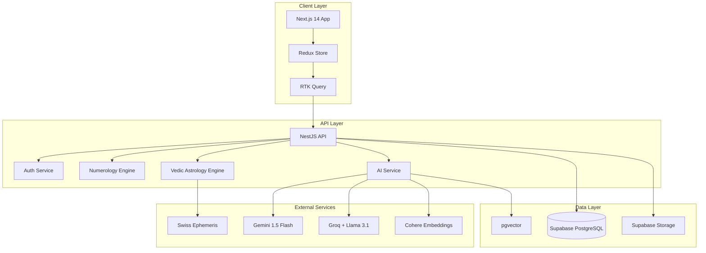
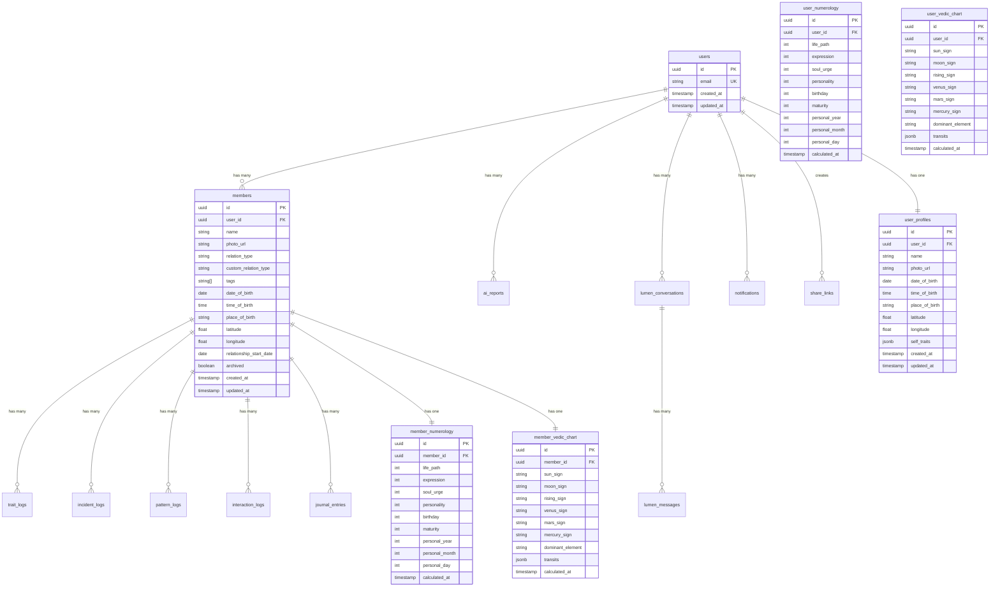
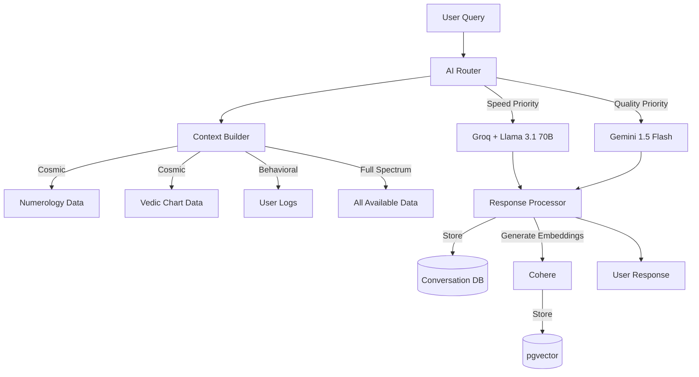
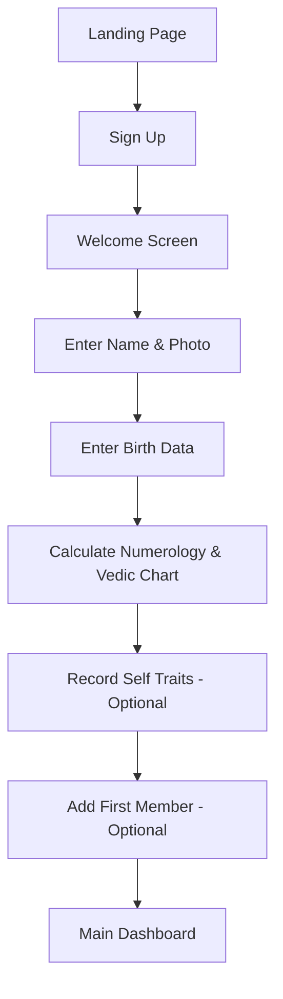
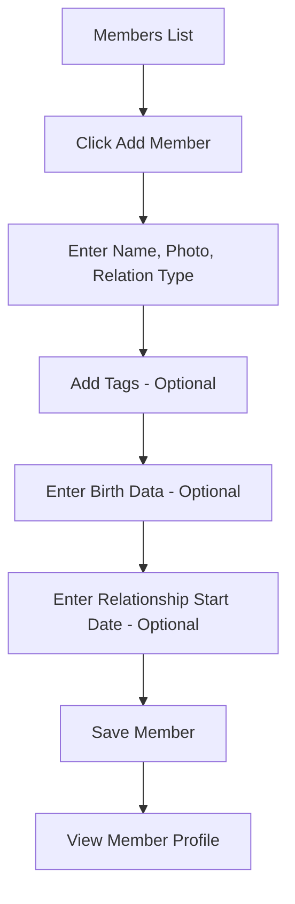
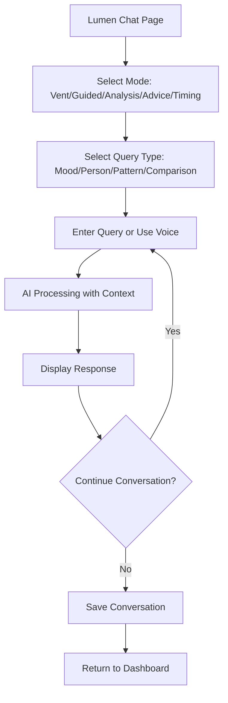
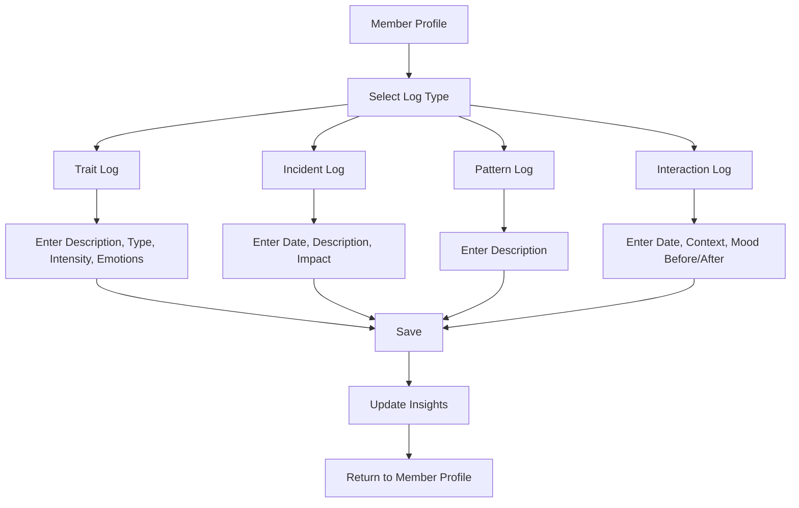

# Design Document: Lumis Core Features

## Overview

Lumis is a relationship intelligence platform that combines numerology, Vedic astrology, and behavioral psychology to help users understand themselves and their relationships. This design document covers the complete technical architecture for the MVP platform.

### System Goals

- Provide accurate numerology and Vedic astrology calculations
- Enable comprehensive relationship tracking and analysis
- Deliver AI-powered insights using Gemini 1.5 Flash and Groq
- Maintain privacy and security through Row-Level Security
- Create a calming, intuitive user experience with the Lumis design system

### Technology Stack

**Frontend:**
- Next.js 14 (App Router)
- React 18 with TypeScript
- Redux Toolkit for state management
- RTK Query for data fetching
- shadcn/ui component library
- Tailwind CSS for styling
- Recharts for data visualization

**Backend:**
- NestJS with TypeScript
- PostgreSQL (Supabase)
- Supabase Auth for authentication
- Supabase Storage for file uploads
- pgvector for embeddings

**AI Services:**
- Gemini 1.5 Flash (primary AI model)
- Groq + Llama 3.1 70B (speed-optimized queries)
- Cohere for embeddings

**External Libraries:**
- swiss-ephemeris for Vedic astrology calculations
- date-fns for date manipulation
- Web Speech API for voice input


## Architecture

### High-Level System Architecture



### Architecture Principles

1. **Privacy First**: All user data protected by Row-Level Security (RLS) policies
2. **Separation of Concerns**: Clear boundaries between UI, business logic, and data layers
3. **Stateless API**: NestJS API is stateless; all state managed client-side or in database
4. **Caching Strategy**: RTK Query handles client-side caching; Supabase handles database caching
5. **AI Orchestration**: Intelligent routing between Gemini (quality) and Groq (speed)
6. **Soft Deletes**: All deletable entities use archived flags for data recovery
7. **Responsive Design**: Mobile-first approach with progressive enhancement

### Service Boundaries

**Frontend Services:**
- Authentication state management
- UI state management (theme, modals, navigation)
- Form validation and submission
- Real-time data synchronization
- Voice input handling

**Backend Services:**
- User authentication and authorization
- Numerology calculations
- Vedic astrology calculations
- AI query processing and response generation
- Data persistence and retrieval
- File upload and storage
- Rate limiting and security


## Components and Interfaces

### Frontend Component Architecture

```mermaid
graph TB
    subgraph "Pages (App Router)"
        Home[/ - Home/Dashboard]
        Profile[/profile - Self Profile]
        Members[/members - Members List]
        MemberDetail[/members/[id] - Member Detail]
        Insights[/insights - Insights Dashboard]
        Lumen[/lumen - Lumen AI Chat]
        Settings[/settings - Settings]
    end
    
    subgraph "Layout Components"
        AppLayout[AppLayout]
        Sidebar[Sidebar]
        Header[Header]
        MobileNav[MobileNav]
    end
    
    subgraph "Feature Components"
        ProfileCard[ProfileCard]
        NumerologyCard[NumerologyCard]
        VedicAstrologyChart[VedicAstrologyChart]
        TraitLogger[TraitLogger]
        IncidentLogger[IncidentLogger]
        PatternLogger[PatternLogger]
        InteractionLogger[InteractionLogger]
        MemberJournal[MemberJournal]
        LumenChat[LumenChat]
        AIReport[AIReport]
        EnergyMap[EnergyMap]
        EmotionalWeatherChart[EmotionalWeatherChart]
        RelationshipHealthScore[RelationshipHealthScore]
    end
    
    subgraph "Shared Components"
        DataTable[DataTable]
        FormField[FormField]
        EmotionPicker[EmotionPicker]
        TimelineLog[TimelineLog]
        Modal[Modal]
        Button[Button]
        Card[Card]
    end
    
    Home --> AppLayout
    Profile --> AppLayout
    Members --> AppLayout
    MemberDetail --> AppLayout
    Insights --> AppLayout
    Lumen --> AppLayout
    Settings --> AppLayout
    
    AppLayout --> Sidebar
    AppLayout --> Header
    AppLayout --> MobileNav
    
    Profile --> ProfileCard
    Profile --> NumerologyCard
    Profile --> VedicAstrologyChart
    
    MemberDetail --> ProfileCard
    MemberDetail --> TraitLogger
    MemberDetail --> IncidentLogger
    MemberDetail --> PatternLogger
    MemberDetail --> InteractionLogger
    MemberDetail --> MemberJournal
    
    Lumen --> LumenChat
    
    Insights --> EnergyMap
    Insights --> EmotionalWeatherChart
    Insights --> RelationshipHealthScore
```

### Core Component Specifications

#### ProfileCard
**Purpose**: Display user or member profile information with photo, bio data, and quick actions

**Props:**
```typescript
interface ProfileCardProps {
  profile: UserProfile | MemberProfile;
  type: 'self' | 'member';
  onEdit?: () => void;
  onArchive?: () => void;
  showActions?: boolean;
}
```

**State:**
- None (controlled component)

**Key Features:**
- Photo display with fallback avatar
- Name and relation type display
- Birth data display (if available)
- Quick action buttons (edit, archive, share)
- Responsive layout


#### NumerologyCard
**Purpose**: Display calculated numerology values with explanations

**Props:**
```typescript
interface NumerologyCardProps {
  numerology: NumerologyData;
  showExplanations?: boolean;
  compact?: boolean;
}

interface NumerologyData {
  lifePath: number;
  expression: number;
  soulUrge: number;
  personality: number;
  birthday: number;
  maturity: number;
  personalYear: number;
  personalMonth: number;
  personalDay: number;
}
```

**State:**
- Expanded/collapsed state for explanations

**Key Features:**
- Core numbers display with master number highlighting
- Personal timing cycles (year, month, day)
- Expandable explanations for each number
- Visual indicators for master numbers (11, 22, 33)

#### VedicAstrologyChart
**Purpose**: Display Vedic astrology chart with planetary placements

**Props:**
```typescript
interface VedicAstrologyChartProps {
  chart: VedicChartData;
  showTransits?: boolean;
  interactive?: boolean;
}

interface VedicChartData {
  sunSign: string;
  moonSign: string;
  risingSign: string;
  venusSign: string;
  marsSign: string;
  mercurySign: string;
  dominantElement: 'Fire' | 'Earth' | 'Air' | 'Water';
  transits?: Transit[];
}
```

**State:**
- Selected planet for detail view
- Transit overlay toggle

**Key Features:**
- Circular chart visualization
- Planetary placement indicators
- Dominant element display
- Current transits overlay
- Interactive planet selection


#### TraitLogger
**Purpose**: Log pros and cons about members with intensity and emotions

**Props:**
```typescript
interface TraitLoggerProps {
  memberId: string;
  onSubmit: (trait: TraitLog) => Promise<void>;
}

interface TraitLog {
  id?: string;
  memberId: string;
  type: 'pro' | 'con';
  description: string;
  intensity: 'mild' | 'moderate' | 'strong';
  emotions: string[];
  timestamp: Date;
}
```

**State:**
- Form data (type, description, intensity, emotions)
- Submission loading state
- Validation errors

**Key Features:**
- Pro/con toggle
- Intensity slider (mild/moderate/strong)
- Emotion picker integration
- Auto-save draft
- Character count

#### LumenChat
**Purpose**: AI conversation interface with mode selection and voice input

**Props:**
```typescript
interface LumenChatProps {
  conversationId?: string;
  initialMode?: LumenMode;
  initialQueryType?: QueryType;
}

type LumenMode = 'vent' | 'guided' | 'analysis' | 'advice' | 'timing';
type QueryType = 'mood' | 'person' | 'pattern' | 'comparison';
```

**State:**
- Messages array
- Current mode
- Current query type
- Analysis depth setting
- Voice recording state
- Loading state

**Key Features:**
- Mode selector (vent, guided, analysis, advice, timing)
- Query type selector
- Voice input button with recording indicator
- Message history with timestamps
- Typing indicator
- Markdown rendering for AI responses
- Context display (which member/data being analyzed)


#### EnergyMap
**Purpose**: Visualize which members energize or drain the user

**Props:**
```typescript
interface EnergyMapProps {
  members: MemberWithEnergy[];
  onMemberClick?: (memberId: string) => void;
}

interface MemberWithEnergy {
  id: string;
  name: string;
  photo?: string;
  energyScore: number; // -100 to +100
  interactionCount: number;
}
```

**State:**
- Selected member
- Filter settings (time range)

**Key Features:**
- Scatter plot visualization (Recharts)
- Color coding (green = energizing, red = draining, gray = neutral)
- Member avatars as data points
- Hover tooltips with details
- Click to navigate to member profile

#### EmotionalWeatherChart
**Purpose**: Time-series visualization of emotional states

**Props:**
```typescript
interface EmotionalWeatherChartProps {
  data: EmotionalDataPoint[];
  timeRange: '7d' | '30d' | '90d' | '1y';
  onTimeRangeChange: (range: string) => void;
}

interface EmotionalDataPoint {
  date: Date;
  averageMood: number; // -5 to +5
  interactions: number;
  dominantEmotion?: string;
}
```

**State:**
- Selected date for detail view
- Time range filter

**Key Features:**
- Line chart with area fill (Recharts)
- Color gradient based on mood (red to green)
- Date range selector
- Hover tooltips with daily details
- Emotion icons on significant days


### API Interface Specifications

#### REST API Endpoints

**Authentication** (handled by Supabase Auth)
- `POST /auth/signup` - Create new user account
- `POST /auth/login` - Authenticate user
- `POST /auth/logout` - End user session
- `POST /auth/refresh` - Refresh access token

**User Profile**
- `GET /api/profile` - Get current user's profile
- `PUT /api/profile` - Update user profile
- `POST /api/profile/photo` - Upload profile photo
- `GET /api/profile/numerology` - Get calculated numerology
- `GET /api/profile/vedic` - Get calculated Vedic chart

**Members**
- `GET /api/members` - List all members (excludes archived)
- `GET /api/members?archived=true` - List archived members
- `POST /api/members` - Create new member
- `GET /api/members/:id` - Get member details
- `PUT /api/members/:id` - Update member
- `DELETE /api/members/:id` - Soft delete (archive) member
- `POST /api/members/:id/restore` - Restore archived member
- `GET /api/members/:id/numerology` - Get member numerology
- `GET /api/members/:id/vedic` - Get member Vedic chart

**Trait Logs**
- `GET /api/members/:id/traits` - List traits for member
- `POST /api/members/:id/traits` - Create trait log
- `PUT /api/traits/:id` - Update trait log
- `DELETE /api/traits/:id` - Soft delete trait log

**Incident Logs**
- `GET /api/members/:id/incidents` - List incidents for member
- `POST /api/members/:id/incidents` - Create incident log
- `PUT /api/incidents/:id` - Update incident log
- `DELETE /api/incidents/:id` - Soft delete incident log

**Pattern Logs**
- `GET /api/members/:id/patterns` - List patterns for member
- `POST /api/members/:id/patterns` - Create pattern log
- `PUT /api/patterns/:id` - Update pattern log
- `DELETE /api/patterns/:id` - Soft delete pattern log

**Interaction Logs**
- `GET /api/members/:id/interactions` - List interactions for member
- `POST /api/members/:id/interactions` - Create interaction log
- `PUT /api/interactions/:id` - Update interaction log
- `DELETE /api/interactions/:id` - Soft delete interaction log
- `GET /api/members/:id/interaction-streak` - Get current streak

**Member Journal**
- `GET /api/members/:id/journal` - List journal entries for member
- `POST /api/members/:id/journal` - Create journal entry
- `PUT /api/journal/:id` - Update journal entry
- `DELETE /api/journal/:id` - Soft delete journal entry
- `GET /api/journal/search?q=query` - Search journal entries


**AI Reports**
- `POST /api/reports/self` - Generate self report
- `POST /api/reports/relationship/:memberId` - Generate relationship report
- `GET /api/reports` - List all reports
- `GET /api/reports/:id` - Get specific report

**Lumen AI**
- `POST /api/lumen/query` - Send query to Lumen AI
- `GET /api/lumen/conversations` - List conversations
- `GET /api/lumen/conversations/:id` - Get conversation history
- `POST /api/lumen/conversations/:id/messages` - Add message to conversation
- `GET /api/lumen/conversations/search?q=query` - Search conversations
- `POST /api/lumen/voice` - Transcribe voice input
- `GET /api/lumen/weekly-digest` - Get latest weekly digest

**Insights**
- `GET /api/insights/health-scores` - Get relationship health scores
- `GET /api/insights/energy-map` - Get energy map data
- `GET /api/insights/emotional-weather` - Get emotional weather data
- `GET /api/insights/emotion-frequency` - Get emotion frequency data
- `GET /api/insights/trigger-map` - Get trigger map data
- `GET /api/insights/attachment-history` - Get attachment style history
- `GET /api/insights/statistics` - Get dashboard statistics

**Calendar**
- `GET /api/calendar?month=YYYY-MM` - Get calendar with timing guidance
- `GET /api/calendar/best-days/:memberId` - Get best days for member

**Notifications**
- `GET /api/notifications` - List notifications
- `PUT /api/notifications/:id/read` - Mark notification as read
- `DELETE /api/notifications/:id` - Dismiss notification

**Sharing**
- `POST /api/share/profile/:memberId` - Create share link for member profile
- `POST /api/share/report/:reportId` - Create share link for report
- `GET /api/share` - List all share links
- `DELETE /api/share/:id` - Revoke share link
- `GET /api/shared/:token` - Access shared content (public endpoint)

**Data Export**
- `POST /api/export` - Request data export
- `GET /api/export/:id` - Download export file

**Search**
- `GET /api/search?q=query&type=members|journal|conversations` - Global search


### Standard API Response Format

All API responses follow this structure:

```typescript
interface APIResponse<T> {
  status: 'success' | 'error';
  data?: T;
  error?: {
    code: string;
    message: string;
    details?: any;
  };
  requestId: string;
  timestamp: string;
}
```

**Success Response Example:**
```json
{
  "status": "success",
  "data": {
    "id": "123",
    "name": "John Doe"
  },
  "requestId": "req_abc123",
  "timestamp": "2024-01-15T10:30:00Z"
}
```

**Error Response Example:**
```json
{
  "status": "error",
  "error": {
    "code": "VALIDATION_ERROR",
    "message": "Invalid birth date format",
    "details": {
      "field": "dateOfBirth",
      "expected": "YYYY-MM-DD"
    }
  },
  "requestId": "req_abc124",
  "timestamp": "2024-01-15T10:31:00Z"
}
```

### Error Codes

- `AUTHENTICATION_REQUIRED` - User not authenticated
- `AUTHORIZATION_FAILED` - User lacks permission
- `VALIDATION_ERROR` - Input validation failed
- `NOT_FOUND` - Resource not found
- `RATE_LIMIT_EXCEEDED` - Too many requests
- `AI_SERVICE_ERROR` - AI service unavailable
- `CALCULATION_ERROR` - Numerology/astrology calculation failed
- `INTERNAL_ERROR` - Unexpected server error


## Data Models

### Database Schema

```mermaid
erDiagram
    trait_logs {
        uuid id PK
        uuid member_id FK
        string type
        text description
        string intensity
        string[] emotions
        boolean archived
        timestamp created_at
        timestamp updated_at
    }
    
    incident_logs {
        uuid id PK
        uuid member_id FK
        date incident_date
        text description
        int emotional_impact
        boolean archived
        timestamp created_at
        timestamp updated_at
    }
    
    pattern_logs {
        uuid id PK
        uuid member_id FK
        text description
        boolean archived
        timestamp created_at
        timestamp updated_at
    }
    
    interaction_logs {
        uuid id PK
        uuid member_id FK
        date interaction_date
        text context
        int mood_before
        int mood_after
        boolean archived
        timestamp created_at
        timestamp updated_at
    }
    
    journal_entries {
        uuid id PK
        uuid member_id FK
        text content
        boolean archived
        timestamp created_at
        timestamp updated_at
    }
    
    ai_reports {
        uuid id PK
        uuid user_id FK
        uuid member_id FK
        string report_type
        jsonb content
        timestamp created_at
    }
    
    lumen_conversations {
        uuid id PK
        uuid user_id FK
        string mode
        string query_type
        string analysis_depth
        timestamp created_at
        timestamp updated_at
    }
    
    lumen_messages {
        uuid id PK
        uuid conversation_id FK
        string role
        text content
        jsonb metadata
        timestamp created_at
    }
    
    notifications {
        uuid id PK
        uuid user_id FK
        string type
        string title
        text message
        jsonb data
        boolean read
        timestamp created_at
    }
    
    share_links {
        uuid id PK
        uuid user_id FK
        string token UK
        string resource_type
        uuid resource_id
        jsonb visibility_settings
        date expires_at
        int view_count
        boolean revoked
        timestamp created_at
    }
    
    daily_mood_logs {
        uuid id PK
        uuid user_id FK
        date log_date
        int mood_rating
        string[] emotions
        timestamp created_at
    }
    
    pattern_alerts {
        uuid id PK
        uuid user_id FK
        text pattern_description
        uuid[] member_ids
        text suggestions
        boolean dismissed
        timestamp created_at
    }
```







### Row-Level Security Policies

All user data tables implement RLS policies to ensure data isolation:

```sql
-- Users can only see their own profile
CREATE POLICY "Users can view own profile"
  ON user_profiles FOR SELECT
  USING (auth.uid() = user_id);

CREATE POLICY "Users can update own profile"
  ON user_profiles FOR UPDATE
  USING (auth.uid() = user_id);

-- Users can only see their own members
CREATE POLICY "Users can view own members"
  ON members FOR SELECT
  USING (auth.uid() = user_id);

CREATE POLICY "Users can insert own members"
  ON members FOR INSERT
  WITH CHECK (auth.uid() = user_id);

CREATE POLICY "Users can update own members"
  ON members FOR UPDATE
  USING (auth.uid() = user_id);

-- Similar policies for all log tables
CREATE POLICY "Users can view own member logs"
  ON trait_logs FOR SELECT
  USING (
    EXISTS (
      SELECT 1 FROM members
      WHERE members.id = trait_logs.member_id
      AND members.user_id = auth.uid()
    )
  );

-- Share links allow public access with valid token
CREATE POLICY "Public can view shared content"
  ON members FOR SELECT
  USING (
    EXISTS (
      SELECT 1 FROM share_links
      WHERE share_links.resource_type = 'member'
      AND share_links.resource_id = members.id
      AND share_links.revoked = false
      AND (share_links.expires_at IS NULL OR share_links.expires_at > NOW())
    )
  );
```

### TypeScript Type Definitions

```typescript
// User Profile
interface UserProfile {
  id: string;
  userId: string;
  name: string;
  photoUrl?: string;
  dateOfBirth?: Date;
  timeOfBirth?: string;
  placeOfBirth?: string;
  latitude?: number;
  longitude?: number;
  selfTraits?: {
    strengths: string[];
    shadows: string[];
    triggers: string[];
    needs: string[];
    patterns: string[];
  };
  createdAt: Date;
  updatedAt: Date;
}

// Member Profile
interface MemberProfile {
  id: string;
  userId: string;
  name: string;
  photoUrl?: string;
  relationType: RelationType;
  customRelationType?: string;
  tags: string[];
  dateOfBirth?: Date;
  timeOfBirth?: string;
  placeOfBirth?: string;
  latitude?: number;
  longitude?: number;
  relationshipStartDate?: Date;
  archived: boolean;
  createdAt: Date;
  updatedAt: Date;
}

type RelationType = 
  | 'friend'
  | 'family'
  | 'colleague'
  | 'partner'
  | 'acquaintance'
  | 'boss'
  | 'mentor'
  | 'therapist'
  | 'coach'
  | 'teacher'
  | 'student'
  | 'neighbor'
  | 'ex-partner'
  | 'other';

// Numerology Data
interface NumerologyData {
  id: string;
  entityId: string; // user_id or member_id
  lifePath: number;
  expression: number;
  soulUrge: number;
  personality: number;
  birthday: number;
  maturity: number;
  personalYear: number;
  personalMonth: number;
  personalDay: number;
  calculatedAt: Date;
}

// Vedic Chart Data
interface VedicChartData {
  id: string;
  entityId: string; // user_id or member_id
  sunSign: string;
  moonSign: string;
  risingSign: string;
  venusSign: string;
  marsSign: string;
  mercurySign: string;
  dominantElement: 'Fire' | 'Earth' | 'Air' | 'Water';
  transits: Transit[];
  calculatedAt: Date;
}

interface Transit {
  planet: string;
  sign: string;
  house: number;
  startDate: Date;
  endDate: Date;
  significance: string;
}
```


```typescript
// Trait Log
interface TraitLog {
  id: string;
  memberId: string;
  type: 'pro' | 'con';
  description: string;
  intensity: 'mild' | 'moderate' | 'strong';
  emotions: string[];
  archived: boolean;
  createdAt: Date;
  updatedAt: Date;
}

// Incident Log
interface IncidentLog {
  id: string;
  memberId: string;
  incidentDate: Date;
  description: string;
  emotionalImpact: number; // -5 to +5
  archived: boolean;
  createdAt: Date;
  updatedAt: Date;
}

// Pattern Log
interface PatternLog {
  id: string;
  memberId: string;
  description: string;
  archived: boolean;
  createdAt: Date;
  updatedAt: Date;
}

// Interaction Log
interface InteractionLog {
  id: string;
  memberId: string;
  interactionDate: Date;
  context: string;
  moodBefore: number; // -5 to +5
  moodAfter: number; // -5 to +5
  archived: boolean;
  createdAt: Date;
  updatedAt: Date;
}

// Journal Entry
interface JournalEntry {
  id: string;
  memberId: string;
  content: string;
  archived: boolean;
  createdAt: Date;
  updatedAt: Date;
}

// AI Report
interface AIReport {
  id: string;
  userId: string;
  memberId?: string;
  reportType: 'self' | 'relationship';
  content: {
    attachmentStyle?: string;
    emotionalTriggerMap?: Record<string, string[]>;
    relationshipPatterns?: string[];
    compatibilityScore?: number;
    dynamicType?: string;
    tensionPoints?: string[];
    growthPoints?: string[];
    forecast?: string;
    timingGuidance?: string;
  };
  createdAt: Date;
}

// Lumen Conversation
interface LumenConversation {
  id: string;
  userId: string;
  mode: LumenMode;
  queryType: QueryType;
  analysisDepth: AnalysisDepth;
  createdAt: Date;
  updatedAt: Date;
}

type LumenMode = 'vent' | 'guided' | 'analysis' | 'advice' | 'timing';
type QueryType = 'mood' | 'person' | 'pattern' | 'comparison';
type AnalysisDepth = 'cosmic' | 'behavioral' | 'full_spectrum';

// Lumen Message
interface LumenMessage {
  id: string;
  conversationId: string;
  role: 'user' | 'assistant';
  content: string;
  metadata?: {
    voiceInput?: boolean;
    membersReferenced?: string[];
    dataUsed?: string[];
  };
  createdAt: Date;
}

// Notification
interface Notification {
  id: string;
  userId: string;
  type: 'birthday' | 'check_in' | 'pattern_alert' | 'weekly_digest';
  title: string;
  message: string;
  data?: any;
  read: boolean;
  createdAt: Date;
}

// Share Link
interface ShareLink {
  id: string;
  userId: string;
  token: string;
  resourceType: 'member' | 'report';
  resourceId: string;
  visibilitySettings: {
    showFullProfile?: boolean;
    showLogs?: boolean;
    showNumerology?: boolean;
    showVedicChart?: boolean;
  };
  expiresAt?: Date;
  viewCount: number;
  revoked: boolean;
  createdAt: Date;
}
```


## Numerology Engine Design

### Calculation Algorithms

#### Life Path Number
```typescript
function calculateLifePath(dateOfBirth: Date): number {
  const day = dateOfBirth.getDate();
  const month = dateOfBirth.getMonth() + 1;
  const year = dateOfBirth.getFullYear();
  
  // Reduce each component separately
  const reducedDay = reduceToSingleDigit(day);
  const reducedMonth = reduceToSingleDigit(month);
  const reducedYear = reduceToSingleDigit(year);
  
  // Sum and reduce again
  const sum = reducedDay + reducedMonth + reducedYear;
  return reduceToSingleDigit(sum);
}

function reduceToSingleDigit(num: number): number {
  // Preserve master numbers 11, 22, 33
  if (num === 11 || num === 22 || num === 33) {
    return num;
  }
  
  while (num > 9) {
    num = num.toString().split('').reduce((acc, digit) => acc + parseInt(digit), 0);
    
    // Check for master numbers after reduction
    if (num === 11 || num === 22 || num === 33) {
      return num;
    }
  }
  
  return num;
}
```

#### Expression Number (from name)
```typescript
function calculateExpression(fullName: string): number {
  const letterValues: Record<string, number> = {
    A: 1, B: 2, C: 3, D: 4, E: 5, F: 6, G: 7, H: 8, I: 9,
    J: 1, K: 2, L: 3, M: 4, N: 5, O: 6, P: 7, Q: 8, R: 9,
    S: 1, T: 2, U: 3, V: 4, W: 5, X: 6, Y: 7, Z: 8
  };
  
  const cleanName = fullName.toUpperCase().replace(/[^A-Z]/g, '');
  const sum = cleanName.split('').reduce((acc, letter) => {
    return acc + (letterValues[letter] || 0);
  }, 0);
  
  return reduceToSingleDigit(sum);
}
```

#### Soul Urge Number (vowels only)
```typescript
function calculateSoulUrge(fullName: string): number {
  const vowels = ['A', 'E', 'I', 'O', 'U'];
  const letterValues: Record<string, number> = {
    A: 1, E: 5, I: 9, O: 6, U: 3
  };
  
  const cleanName = fullName.toUpperCase().replace(/[^A-Z]/g, '');
  const sum = cleanName.split('').reduce((acc, letter) => {
    if (vowels.includes(letter)) {
      return acc + (letterValues[letter] || 0);
    }
    return acc;
  }, 0);
  
  return reduceToSingleDigit(sum);
}
```

#### Personality Number (consonants only)
```typescript
function calculatePersonality(fullName: string): number {
  const vowels = ['A', 'E', 'I', 'O', 'U'];
  const letterValues: Record<string, number> = {
    B: 2, C: 3, D: 4, F: 6, G: 7, H: 8,
    J: 1, K: 2, L: 3, M: 4, N: 5, P: 7, Q: 8, R: 9,
    S: 1, T: 2, V: 4, W: 5, X: 6, Y: 7, Z: 8
  };
  
  const cleanName = fullName.toUpperCase().replace(/[^A-Z]/g, '');
  const sum = cleanName.split('').reduce((acc, letter) => {
    if (!vowels.includes(letter)) {
      return acc + (letterValues[letter] || 0);
    }
    return acc;
  }, 0);
  
  return reduceToSingleDigit(sum);
}
```

#### Birthday Number
```typescript
function calculateBirthday(dateOfBirth: Date): number {
  const day = dateOfBirth.getDate();
  return reduceToSingleDigit(day);
}
```

#### Maturity Number
```typescript
function calculateMaturity(lifePath: number, expression: number): number {
  return reduceToSingleDigit(lifePath + expression);
}
```

#### Personal Year
```typescript
function calculatePersonalYear(dateOfBirth: Date, currentYear: number): number {
  const day = dateOfBirth.getDate();
  const month = dateOfBirth.getMonth() + 1;
  
  const reducedDay = reduceToSingleDigit(day);
  const reducedMonth = reduceToSingleDigit(month);
  const reducedYear = reduceToSingleDigit(currentYear);
  
  const sum = reducedDay + reducedMonth + reducedYear;
  return reduceToSingleDigit(sum);
}
```

#### Personal Month
```typescript
function calculatePersonalMonth(personalYear: number, currentMonth: number): number {
  const reducedMonth = reduceToSingleDigit(currentMonth);
  return reduceToSingleDigit(personalYear + reducedMonth);
}
```

#### Personal Day
```typescript
function calculatePersonalDay(personalMonth: number, currentDay: number): number {
  const reducedDay = reduceToSingleDigit(currentDay);
  return reduceToSingleDigit(personalMonth + reducedDay);
}
```

### Numerology Service Implementation

```typescript
@Injectable()
export class NumerologyService {
  calculateAll(
    fullName: string,
    dateOfBirth: Date,
    currentDate: Date = new Date()
  ): NumerologyData {
    const lifePath = calculateLifePath(dateOfBirth);
    const expression = calculateExpression(fullName);
    const soulUrge = calculateSoulUrge(fullName);
    const personality = calculatePersonality(fullName);
    const birthday = calculateBirthday(dateOfBirth);
    const maturity = calculateMaturity(lifePath, expression);
    
    const personalYear = calculatePersonalYear(dateOfBirth, currentDate.getFullYear());
    const personalMonth = calculatePersonalMonth(personalYear, currentDate.getMonth() + 1);
    const personalDay = calculatePersonalDay(personalMonth, currentDate.getDate());
    
    return {
      lifePath,
      expression,
      soulUrge,
      personality,
      birthday,
      maturity,
      personalYear,
      personalMonth,
      personalDay,
      calculatedAt: new Date()
    };
  }
}
```


## Vedic Astrology Engine Design

### Swiss Ephemeris Integration

The Vedic astrology engine uses the Swiss Ephemeris library for accurate planetary calculations with Vedic sidereal zodiac.

```typescript
import swisseph from 'swisseph';

@Injectable()
export class VedicAstrologyService {
  private readonly AYANAMSA = swisseph.SE_SIDM_LAHIRI; // Lahiri ayanamsa
  
  constructor() {
    // Set ephemeris path for data files
    swisseph.swe_set_ephe_path('/path/to/ephemeris/data');
  }
  
  calculateChart(
    dateOfBirth: Date,
    timeOfBirth: string, // HH:MM format
    latitude: number,
    longitude: number
  ): VedicChartData {
    // Set sidereal mode with Lahiri ayanamsa
    swisseph.swe_set_sid_mode(this.AYANAMSA, 0, 0);
    
    // Calculate Julian day
    const [hours, minutes] = timeOfBirth.split(':').map(Number);
    const julianDay = this.calculateJulianDay(dateOfBirth, hours, minutes);
    
    // Calculate planetary positions
    const sun = this.getPlanetPosition(swisseph.SE_SUN, julianDay);
    const moon = this.getPlanetPosition(swisseph.SE_MOON, julianDay);
    const venus = this.getPlanetPosition(swisseph.SE_VENUS, julianDay);
    const mars = this.getPlanetPosition(swisseph.SE_MARS, julianDay);
    const mercury = this.getPlanetPosition(swisseph.SE_MERCURY, julianDay);
    
    // Calculate houses and ascendant
    const houses = this.calculateHouses(julianDay, latitude, longitude);
    const ascendant = houses[0]; // First house cusp is ascendant
    
    // Determine signs
    const sunSign = this.getZodiacSign(sun.longitude);
    const moonSign = this.getZodiacSign(moon.longitude);
    const risingSign = this.getZodiacSign(ascendant);
    const venusSign = this.getZodiacSign(venus.longitude);
    const marsSign = this.getZodiacSign(mars.longitude);
    const mercurySign = this.getZodiacSign(mercury.longitude);
    
    // Calculate dominant element
    const dominantElement = this.calculateDominantElement([
      sunSign, moonSign, risingSign, venusSign, marsSign, mercurySign
    ]);
    
    // Calculate current transits
    const transits = this.calculateTransits(new Date(), houses);
    
    return {
      sunSign,
      moonSign,
      risingSign,
      venusSign,
      marsSign,
      mercurySign,
      dominantElement,
      transits,
      calculatedAt: new Date()
    };
  }
  
  private calculateJulianDay(date: Date, hours: number, minutes: number): number {
    const year = date.getFullYear();
    const month = date.getMonth() + 1;
    const day = date.getDate();
    const hour = hours + minutes / 60;
    
    return swisseph.swe_julday(year, month, day, hour, swisseph.SE_GREG_CAL);
  }
  
  private getPlanetPosition(planet: number, julianDay: number) {
    const flags = swisseph.SEFLG_SIDEREAL | swisseph.SEFLG_SPEED;
    const result = swisseph.swe_calc_ut(julianDay, planet, flags);
    
    if (result.flag < 0) {
      throw new Error(`Failed to calculate planet position: ${result.error}`);
    }
    
    return {
      longitude: result.longitude,
      latitude: result.latitude,
      speed: result.longitudeSpeed
    };
  }
  
  private calculateHouses(julianDay: number, latitude: number, longitude: number): number[] {
    const flags = swisseph.SEFLG_SIDEREAL;
    const result = swisseph.swe_houses(
      julianDay,
      latitude,
      longitude,
      'P', // Placidus house system
      flags
    );
    
    if (!result.house) {
      throw new Error('Failed to calculate houses');
    }
    
    return result.house;
  }
  
  private getZodiacSign(longitude: number): string {
    const signs = [
      'Aries', 'Taurus', 'Gemini', 'Cancer', 'Leo', 'Virgo',
      'Libra', 'Scorpio', 'Sagittarius', 'Capricorn', 'Aquarius', 'Pisces'
    ];
    
    const signIndex = Math.floor(longitude / 30);
    return signs[signIndex];
  }
  
  private calculateDominantElement(signs: string[]): 'Fire' | 'Earth' | 'Air' | 'Water' {
    const elementMap: Record<string, string> = {
      'Aries': 'Fire', 'Leo': 'Fire', 'Sagittarius': 'Fire',
      'Taurus': 'Earth', 'Virgo': 'Earth', 'Capricorn': 'Earth',
      'Gemini': 'Air', 'Libra': 'Air', 'Aquarius': 'Air',
      'Cancer': 'Water', 'Scorpio': 'Water', 'Pisces': 'Water'
    };
    
    const elementCounts: Record<string, number> = {
      Fire: 0, Earth: 0, Air: 0, Water: 0
    };
    
    signs.forEach(sign => {
      const element = elementMap[sign];
      if (element) {
        elementCounts[element]++;
      }
    });
    
    // Return element with highest count
    return Object.entries(elementCounts)
      .sort(([, a], [, b]) => b - a)[0][0] as 'Fire' | 'Earth' | 'Air' | 'Water';
  }
  
  private calculateTransits(currentDate: Date, natalHouses: number[]): Transit[] {
    const julianDay = this.calculateJulianDay(currentDate, 12, 0);
    const transits: Transit[] = [];
    
    // Calculate current positions of major planets
    const planets = [
      { id: swisseph.SE_JUPITER, name: 'Jupiter' },
      { id: swisseph.SE_SATURN, name: 'Saturn' },
      { id: swisseph.SE_MARS, name: 'Mars' }
    ];
    
    planets.forEach(planet => {
      const position = this.getPlanetPosition(planet.id, julianDay);
      const sign = this.getZodiacSign(position.longitude);
      const house = this.getHouseForLongitude(position.longitude, natalHouses);
      
      transits.push({
        planet: planet.name,
        sign,
        house,
        startDate: currentDate, // Simplified - would need ephemeris lookup for exact dates
        endDate: new Date(currentDate.getTime() + 90 * 24 * 60 * 60 * 1000), // Approximate
        significance: this.getTransitSignificance(planet.name, house)
      });
    });
    
    return transits;
  }
  
  private getHouseForLongitude(longitude: number, houses: number[]): number {
    for (let i = 0; i < houses.length - 1; i++) {
      if (longitude >= houses[i] && longitude < houses[i + 1]) {
        return i + 1;
      }
    }
    return 12; // Last house
  }
  
  private getTransitSignificance(planet: string, house: number): string {
    const significanceMap: Record<string, Record<number, string>> = {
      'Jupiter': {
        1: 'Personal growth and new opportunities',
        7: 'Relationship expansion and partnerships',
        10: 'Career advancement and recognition'
      },
      'Saturn': {
        1: 'Personal responsibility and discipline',
        7: 'Relationship commitments and boundaries',
        10: 'Career challenges and long-term goals'
      },
      'Mars': {
        1: 'Increased energy and assertiveness',
        7: 'Relationship passion or conflicts',
        10: 'Career drive and ambition'
      }
    };
    
    return significanceMap[planet]?.[house] || 'General influence';
  }
}
```


## Lumen AI Integration Design

### AI Service Architecture



### AI Service Implementation

```typescript
@Injectable()
export class LumenAIService {
  constructor(
    private readonly geminiClient: GeminiClient,
    private readonly groqClient: GroqClient,
    private readonly cohereClient: CohereClient,
    private readonly contextBuilder: ContextBuilderService,
    private readonly conversationRepository: ConversationRepository,
    private readonly vectorStore: VectorStoreService
  ) {}
  
  async processQuery(
    userId: string,
    query: string,
    options: {
      mode: LumenMode;
      queryType: QueryType;
      analysisDepth: AnalysisDepth;
      conversationId?: string;
      voiceInput?: boolean;
    }
  ): Promise<LumenResponse> {
    // Build context based on analysis depth
    const context = await this.contextBuilder.buildContext(userId, {
      depth: options.analysisDepth,
      queryType: options.queryType
    });
    
    // Select AI model based on query characteristics
    const useGroq = this.shouldUseGroq(query, options.mode);
    
    // Build system prompt based on mode
    const systemPrompt = this.buildSystemPrompt(options.mode, context);
    
    // Get or create conversation
    const conversation = options.conversationId
      ? await this.conversationRepository.findById(options.conversationId)
      : await this.conversationRepository.create({
          userId,
          mode: options.mode,
          queryType: options.queryType,
          analysisDepth: options.analysisDepth
        });
    
    // Get conversation history
    const history = await this.conversationRepository.getMessages(conversation.id);
    
    // Generate response
    const response = useGroq
      ? await this.queryGroq(systemPrompt, query, history)
      : await this.queryGemini(systemPrompt, query, history);
    
    // Store messages
    await this.conversationRepository.addMessage(conversation.id, {
      role: 'user',
      content: query,
      metadata: { voiceInput: options.voiceInput }
    });
    
    await this.conversationRepository.addMessage(conversation.id, {
      role: 'assistant',
      content: response.content,
      metadata: { model: useGroq ? 'groq' : 'gemini' }
    });
    
    // Generate and store embeddings for semantic search
    await this.storeEmbeddings(conversation.id, query, response.content);
    
    return {
      conversationId: conversation.id,
      content: response.content,
      model: useGroq ? 'groq' : 'gemini'
    };
  }
  
  private shouldUseGroq(query: string, mode: LumenMode): boolean {
    // Use Groq for speed-critical queries
    const speedModes: LumenMode[] = ['vent', 'guided'];
    const isShortQuery = query.length < 200;
    
    return speedModes.includes(mode) || isShortQuery;
  }
  
  private buildSystemPrompt(mode: LumenMode, context: AIContext): string {
    const basePrompt = `You are Lumen, an AI companion specializing in relationship intelligence. 
You combine insights from numerology, Vedic astrology, and evidence-based psychology to help users 
understand themselves and their relationships.

You are trauma-informed, compassionate, and non-judgmental. You use Nonviolent Communication principles 
and apply frameworks like attachment theory, cognitive behavioral therapy, and Jungian psychology.`;
    
    const modePrompts: Record<LumenMode, string> = {
      vent: `${basePrompt}

Current mode: VENT
The user needs to express emotions without advice. Listen actively, validate feelings, and reflect back 
what you hear. Do NOT offer solutions or advice unless explicitly asked.`,
      
      guided: `${basePrompt}

Current mode: GUIDED
Ask thoughtful questions to help the user explore their feelings and situation. Guide them toward 
their own insights through Socratic questioning.`,
      
      analysis: `${basePrompt}

Current mode: ANALYSIS
Provide objective pattern identification and analysis. Point out recurring themes, behavioral patterns, 
and potential blind spots. Be direct but compassionate.`,
      
      advice: `${basePrompt}

Current mode: ADVICE
Offer actionable recommendations based on the user's data and psychological frameworks. Provide specific 
strategies and techniques they can implement.`,
      
      timing: `${basePrompt}

Current mode: TIMING
Focus on numerological and astrological timing guidance. Explain current cycles, transits, and favorable 
periods for specific actions or decisions.`
    };
    
    const contextPrompt = this.formatContext(context);
    
    return `${modePrompts[mode]}

${contextPrompt}`;
  }
  
  private formatContext(context: AIContext): string {
    let prompt = '\n--- USER CONTEXT ---\n';
    
    if (context.numerology) {
      prompt += `\nNumerology:
- Life Path: ${context.numerology.lifePath}
- Personal Year: ${context.numerology.personalYear}
- Personal Month: ${context.numerology.personalMonth}`;
    }
    
    if (context.vedicChart) {
      prompt += `\n\nVedic Astrology:
- Sun Sign: ${context.vedicChart.sunSign}
- Moon Sign: ${context.vedicChart.moonSign}
- Rising Sign: ${context.vedicChart.risingSign}
- Dominant Element: ${context.vedicChart.dominantElement}`;
      
      if (context.vedicChart.transits?.length > 0) {
        prompt += `\n- Current Transits: ${context.vedicChart.transits.map(t => 
          `${t.planet} in ${t.sign} (House ${t.house})`
        ).join(', ')}`;
      }
    }
    
    if (context.recentInteractions?.length > 0) {
      prompt += `\n\nRecent Interactions (last 7 days):`;
      context.recentInteractions.forEach(interaction => {
        prompt += `\n- ${interaction.memberName}: Mood ${interaction.moodBefore} → ${interaction.moodAfter}`;
      });
    }
    
    if (context.traits?.length > 0) {
      prompt += `\n\nRecent Trait Observations:`;
      context.traits.slice(0, 5).forEach(trait => {
        prompt += `\n- ${trait.memberName}: ${trait.type === 'pro' ? '✓' : '✗'} ${trait.description} (${trait.intensity})`;
      });
    }
    
    if (context.patterns?.length > 0) {
      prompt += `\n\nIdentified Patterns:`;
      context.patterns.forEach(pattern => {
        prompt += `\n- ${pattern.memberName}: ${pattern.description}`;
      });
    }
    
    prompt += '\n--- END CONTEXT ---\n';
    
    return prompt;
  }
  
  private async queryGemini(
    systemPrompt: string,
    userQuery: string,
    history: LumenMessage[]
  ): Promise<{ content: string }> {
    const messages = [
      { role: 'system', content: systemPrompt },
      ...history.map(msg => ({ role: msg.role, content: msg.content })),
      { role: 'user', content: userQuery }
    ];
    
    const response = await this.geminiClient.generateContent({
      model: 'gemini-1.5-flash',
      messages,
      temperature: 0.7,
      maxTokens: 2000
    });
    
    return { content: response.text };
  }
  
  private async queryGroq(
    systemPrompt: string,
    userQuery: string,
    history: LumenMessage[]
  ): Promise<{ content: string }> {
    const messages = [
      { role: 'system', content: systemPrompt },
      ...history.map(msg => ({ role: msg.role, content: msg.content })),
      { role: 'user', content: userQuery }
    ];
    
    const response = await this.groqClient.chat.completions.create({
      model: 'llama-3.1-70b-versatile',
      messages,
      temperature: 0.7,
      max_tokens: 2000
    });
    
    return { content: response.choices[0].message.content };
  }
  
  private async storeEmbeddings(
    conversationId: string,
    query: string,
    response: string
  ): Promise<void> {
    const combinedText = `Q: ${query}\nA: ${response}`;
    
    const embedding = await this.cohereClient.embed({
      texts: [combinedText],
      model: 'embed-english-v3.0'
    });
    
    await this.vectorStore.store({
      conversationId,
      text: combinedText,
      embedding: embedding.embeddings[0]
    });
  }
}
```


### Context Builder Service

```typescript
@Injectable()
export class ContextBuilderService {
  constructor(
    private readonly userRepository: UserRepository,
    private readonly memberRepository: MemberRepository,
    private readonly numerologyService: NumerologyService,
    private readonly vedicService: VedicAstrologyService,
    private readonly logsRepository: LogsRepository
  ) {}
  
  async buildContext(
    userId: string,
    options: {
      depth: AnalysisDepth;
      queryType: QueryType;
      memberId?: string;
    }
  ): Promise<AIContext> {
    const context: AIContext = {};
    
    // Get user profile
    const userProfile = await this.userRepository.findById(userId);
    
    // Cosmic depth: numerology and Vedic astrology only
    if (options.depth === 'cosmic' || options.depth === 'full_spectrum') {
      context.numerology = await this.numerologyService.getForUser(userId);
      context.vedicChart = await this.vedicService.getForUser(userId);
    }
    
    // Behavioral depth: logs and patterns only
    if (options.depth === 'behavioral' || options.depth === 'full_spectrum') {
      const sevenDaysAgo = new Date();
      sevenDaysAgo.setDate(sevenDaysAgo.getDate() - 7);
      
      context.recentInteractions = await this.logsRepository.getInteractions(userId, {
        since: sevenDaysAgo
      });
      
      context.traits = await this.logsRepository.getTraits(userId, {
        limit: 10,
        orderBy: 'created_at',
        order: 'DESC'
      });
      
      context.patterns = await this.logsRepository.getPatterns(userId);
    }
    
    // Query-specific context
    if (options.queryType === 'person' && options.memberId) {
      const member = await this.memberRepository.findById(options.memberId);
      context.focusMember = {
        name: member.name,
        relationType: member.relationType,
        numerology: await this.numerologyService.getForMember(options.memberId),
        vedicChart: await this.vedicService.getForMember(options.memberId),
        traits: await this.logsRepository.getTraitsForMember(options.memberId),
        interactions: await this.logsRepository.getInteractionsForMember(options.memberId)
      };
    }
    
    return context;
  }
}

interface AIContext {
  numerology?: NumerologyData;
  vedicChart?: VedicChartData;
  recentInteractions?: Array<{
    memberName: string;
    moodBefore: number;
    moodAfter: number;
    date: Date;
  }>;
  traits?: Array<{
    memberName: string;
    type: 'pro' | 'con';
    description: string;
    intensity: string;
  }>;
  patterns?: Array<{
    memberName: string;
    description: string;
  }>;
  focusMember?: {
    name: string;
    relationType: string;
    numerology?: NumerologyData;
    vedicChart?: VedicChartData;
    traits?: TraitLog[];
    interactions?: InteractionLog[];
  };
}
```

### AI Report Generation

```typescript
@Injectable()
export class AIReportService {
  constructor(
    private readonly lumenAIService: LumenAIService,
    private readonly contextBuilder: ContextBuilderService,
    private readonly reportRepository: ReportRepository
  ) {}
  
  async generateSelfReport(userId: string): Promise<AIReport> {
    const context = await this.contextBuilder.buildContext(userId, {
      depth: 'full_spectrum',
      queryType: 'mood'
    });
    
    const prompt = `Generate a comprehensive self-report for this user. Include:
1. Inferred attachment style based on interaction patterns and emotional responses
2. Emotional trigger map identifying common triggers and responses
3. Relationship patterns observed across multiple connections
4. Integration of numerological and astrological insights
5. Recommendations for personal growth

Format the response as structured JSON.`;
    
    const response = await this.lumenAIService.processQuery(userId, prompt, {
      mode: 'analysis',
      queryType: 'mood',
      analysisDepth: 'full_spectrum'
    });
    
    const content = this.parseReportContent(response.content);
    
    const report = await this.reportRepository.create({
      userId,
      reportType: 'self',
      content
    });
    
    return report;
  }
  
  async generateRelationshipReport(
    userId: string,
    memberId: string
  ): Promise<AIReport> {
    const context = await this.contextBuilder.buildContext(userId, {
      depth: 'full_spectrum',
      queryType: 'person',
      memberId
    });
    
    const prompt = `Generate a comprehensive relationship report for this user and member. Include:
1. Compatibility score (0-100) based on numerology and Vedic astrology
2. Dynamic type (e.g., "Growth Partnership", "Challenging Mirror", "Comfortable Companion")
3. Tension points identified from logs and cosmic incompatibilities
4. Growth points and opportunities for deeper connection
5. Forecast for the next 3 months based on transits and personal cycles
6. Timing guidance for important conversations or decisions

Format the response as structured JSON.`;
    
    const response = await this.lumenAIService.processQuery(userId, prompt, {
      mode: 'analysis',
      queryType: 'person',
      analysisDepth: 'full_spectrum'
    });
    
    const content = this.parseReportContent(response.content);
    
    const report = await this.reportRepository.create({
      userId,
      memberId,
      reportType: 'relationship',
      content
    });
    
    return report;
  }
  
  private parseReportContent(rawContent: string): any {
    // Extract JSON from markdown code blocks if present
    const jsonMatch = rawContent.match(/```json\n([\s\S]*?)\n```/);
    if (jsonMatch) {
      return JSON.parse(jsonMatch[1]);
    }
    
    // Try parsing as direct JSON
    try {
      return JSON.parse(rawContent);
    } catch {
      // Fallback: return as plain text
      return { rawContent };
    }
  }
}
```

### Rate Limiting Implementation

```typescript
@Injectable()
export class RateLimitService {
  private readonly limits = new Map<string, { count: number; resetAt: Date }>();
  
  private readonly MAX_REQUESTS = 10;
  private readonly WINDOW_MS = 60000; // 1 minute
  
  async checkLimit(userId: string): Promise<{ allowed: boolean; retryAfter?: number }> {
    const now = new Date();
    const userLimit = this.limits.get(userId);
    
    // No existing limit or window expired
    if (!userLimit || now >= userLimit.resetAt) {
      this.limits.set(userId, {
        count: 1,
        resetAt: new Date(now.getTime() + this.WINDOW_MS)
      });
      return { allowed: true };
    }
    
    // Within window, check count
    if (userLimit.count < this.MAX_REQUESTS) {
      userLimit.count++;
      return { allowed: true };
    }
    
    // Rate limit exceeded
    const retryAfter = Math.ceil((userLimit.resetAt.getTime() - now.getTime()) / 1000);
    return { allowed: false, retryAfter };
  }
  
  // Cleanup expired entries periodically
  @Cron('*/5 * * * *') // Every 5 minutes
  cleanupExpired() {
    const now = new Date();
    for (const [userId, limit] of this.limits.entries()) {
      if (now >= limit.resetAt) {
        this.limits.delete(userId);
      }
    }
  }
}
```


## State Management

### Redux Store Structure

```typescript
// Root state interface
interface RootState {
  auth: AuthState;
  ui: UIState;
  profile: ProfileState;
  members: MembersState;
  insights: InsightsState;
  lumen: LumenState;
}

// Auth slice
interface AuthState {
  user: User | null;
  session: Session | null;
  loading: boolean;
  error: string | null;
}

// UI slice
interface UIState {
  theme: 'light' | 'dark';
  sidebarOpen: boolean;
  journalMode: boolean;
  activeModal: string | null;
  notifications: Notification[];
}

// Profile slice
interface ProfileState {
  profile: UserProfile | null;
  numerology: NumerologyData | null;
  vedicChart: VedicChartData | null;
  loading: boolean;
  error: string | null;
}

// Members slice
interface MembersState {
  members: MemberProfile[];
  selectedMember: MemberProfile | null;
  filters: {
    relationType: RelationType | null;
    tags: string[];
    archived: boolean;
  };
  loading: boolean;
  error: string | null;
}

// Insights slice
interface InsightsState {
  healthScores: Record<string, number>;
  energyMap: EnergyMapData | null;
  emotionalWeather: EmotionalDataPoint[];
  statistics: DashboardStatistics | null;
  loading: boolean;
  error: string | null;
}

// Lumen slice
interface LumenState {
  conversations: LumenConversation[];
  activeConversation: string | null;
  messages: Record<string, LumenMessage[]>;
  mode: LumenMode;
  queryType: QueryType;
  analysisDepth: AnalysisDepth;
  voiceRecording: boolean;
  loading: boolean;
  error: string | null;
}
```

### Redux Slices

```typescript
// auth.slice.ts
import { createSlice, PayloadAction } from '@reduxjs/toolkit';

const authSlice = createSlice({
  name: 'auth',
  initialState: {
    user: null,
    session: null,
    loading: false,
    error: null
  } as AuthState,
  reducers: {
    setUser: (state, action: PayloadAction<User>) => {
      state.user = action.payload;
    },
    setSession: (state, action: PayloadAction<Session>) => {
      state.session = action.payload;
    },
    clearAuth: (state) => {
      state.user = null;
      state.session = null;
    },
    setLoading: (state, action: PayloadAction<boolean>) => {
      state.loading = action.payload;
    },
    setError: (state, action: PayloadAction<string | null>) => {
      state.error = action.payload;
    }
  }
});

export const { setUser, setSession, clearAuth, setLoading, setError } = authSlice.actions;
export default authSlice.reducer;

// ui.slice.ts
const uiSlice = createSlice({
  name: 'ui',
  initialState: {
    theme: 'light',
    sidebarOpen: true,
    journalMode: false,
    activeModal: null,
    notifications: []
  } as UIState,
  reducers: {
    setTheme: (state, action: PayloadAction<'light' | 'dark'>) => {
      state.theme = action.payload;
    },
    toggleSidebar: (state) => {
      state.sidebarOpen = !state.sidebarOpen;
    },
    setJournalMode: (state, action: PayloadAction<boolean>) => {
      state.journalMode = action.payload;
    },
    openModal: (state, action: PayloadAction<string>) => {
      state.activeModal = action.payload;
    },
    closeModal: (state) => {
      state.activeModal = null;
    },
    addNotification: (state, action: PayloadAction<Notification>) => {
      state.notifications.push(action.payload);
    },
    removeNotification: (state, action: PayloadAction<string>) => {
      state.notifications = state.notifications.filter(n => n.id !== action.payload);
    }
  }
});

export const {
  setTheme,
  toggleSidebar,
  setJournalMode,
  openModal,
  closeModal,
  addNotification,
  removeNotification
} = uiSlice.actions;
export default uiSlice.reducer;

// lumen.slice.ts
const lumenSlice = createSlice({
  name: 'lumen',
  initialState: {
    conversations: [],
    activeConversation: null,
    messages: {},
    mode: 'analysis',
    queryType: 'mood',
    analysisDepth: 'full_spectrum',
    voiceRecording: false,
    loading: false,
    error: null
  } as LumenState,
  reducers: {
    setMode: (state, action: PayloadAction<LumenMode>) => {
      state.mode = action.payload;
    },
    setQueryType: (state, action: PayloadAction<QueryType>) => {
      state.queryType = action.payload;
    },
    setAnalysisDepth: (state, action: PayloadAction<AnalysisDepth>) => {
      state.analysisDepth = action.payload;
    },
    setActiveConversation: (state, action: PayloadAction<string | null>) => {
      state.activeConversation = action.payload;
    },
    setVoiceRecording: (state, action: PayloadAction<boolean>) => {
      state.voiceRecording = action.payload;
    },
    addMessage: (state, action: PayloadAction<{ conversationId: string; message: LumenMessage }>) => {
      const { conversationId, message } = action.payload;
      if (!state.messages[conversationId]) {
        state.messages[conversationId] = [];
      }
      state.messages[conversationId].push(message);
    }
  }
});

export const {
  setMode,
  setQueryType,
  setAnalysisDepth,
  setActiveConversation,
  setVoiceRecording,
  addMessage
} = lumenSlice.actions;
export default lumenSlice.reducer;
```


### RTK Query API Slices

```typescript
// api.slice.ts
import { createApi, fetchBaseQuery } from '@reduxjs/toolkit/query/react';
import type { RootState } from './store';

export const api = createApi({
  reducerPath: 'api',
  baseQuery: fetchBaseQuery({
    baseUrl: '/api',
    prepareHeaders: (headers, { getState }) => {
      const token = (getState() as RootState).auth.session?.access_token;
      if (token) {
        headers.set('authorization', `Bearer ${token}`);
      }
      return headers;
    }
  }),
  tagTypes: [
    'Profile',
    'Members',
    'Numerology',
    'VedicChart',
    'Traits',
    'Incidents',
    'Patterns',
    'Interactions',
    'Journal',
    'Reports',
    'Conversations',
    'Insights',
    'Notifications'
  ],
  endpoints: (builder) => ({
    // Profile endpoints
    getProfile: builder.query<UserProfile, void>({
      query: () => '/profile',
      providesTags: ['Profile']
    }),
    updateProfile: builder.mutation<UserProfile, Partial<UserProfile>>({
      query: (data) => ({
        url: '/profile',
        method: 'PUT',
        body: data
      }),
      invalidatesTags: ['Profile', 'Numerology', 'VedicChart']
    }),
    
    // Members endpoints
    getMembers: builder.query<MemberProfile[], { archived?: boolean }>({
      query: ({ archived = false }) => `/members?archived=${archived}`,
      providesTags: ['Members']
    }),
    getMember: builder.query<MemberProfile, string>({
      query: (id) => `/members/${id}`,
      providesTags: (result, error, id) => [{ type: 'Members', id }]
    }),
    createMember: builder.mutation<MemberProfile, Partial<MemberProfile>>({
      query: (data) => ({
        url: '/members',
        method: 'POST',
        body: data
      }),
      invalidatesTags: ['Members']
    }),
    updateMember: builder.mutation<MemberProfile, { id: string; data: Partial<MemberProfile> }>({
      query: ({ id, data }) => ({
        url: `/members/${id}`,
        method: 'PUT',
        body: data
      }),
      invalidatesTags: (result, error, { id }) => [
        'Members',
        { type: 'Members', id },
        'Numerology',
        'VedicChart'
      ]
    }),
    archiveMember: builder.mutation<void, string>({
      query: (id) => ({
        url: `/members/${id}`,
        method: 'DELETE'
      }),
      invalidatesTags: ['Members']
    }),
    
    // Trait logs endpoints
    getTraits: builder.query<TraitLog[], string>({
      query: (memberId) => `/members/${memberId}/traits`,
      providesTags: (result, error, memberId) => [{ type: 'Traits', id: memberId }]
    }),
    createTrait: builder.mutation<TraitLog, { memberId: string; data: Partial<TraitLog> }>({
      query: ({ memberId, data }) => ({
        url: `/members/${memberId}/traits`,
        method: 'POST',
        body: data
      }),
      invalidatesTags: (result, error, { memberId }) => [
        { type: 'Traits', id: memberId },
        'Insights'
      ]
    }),
    
    // Interaction logs endpoints
    getInteractions: builder.query<InteractionLog[], string>({
      query: (memberId) => `/members/${memberId}/interactions`,
      providesTags: (result, error, memberId) => [{ type: 'Interactions', id: memberId }]
    }),
    createInteraction: builder.mutation<InteractionLog, { memberId: string; data: Partial<InteractionLog> }>({
      query: ({ memberId, data }) => ({
        url: `/members/${memberId}/interactions`,
        method: 'POST',
        body: data
      }),
      invalidatesTags: (result, error, { memberId }) => [
        { type: 'Interactions', id: memberId },
        'Insights'
      ]
    }),
    
    // Journal endpoints
    getJournalEntries: builder.query<JournalEntry[], string>({
      query: (memberId) => `/members/${memberId}/journal`,
      providesTags: (result, error, memberId) => [{ type: 'Journal', id: memberId }]
    }),
    createJournalEntry: builder.mutation<JournalEntry, { memberId: string; content: string }>({
      query: ({ memberId, content }) => ({
        url: `/members/${memberId}/journal`,
        method: 'POST',
        body: { content }
      }),
      invalidatesTags: (result, error, { memberId }) => [{ type: 'Journal', id: memberId }]
    }),
    
    // Lumen AI endpoints
    sendLumenQuery: builder.mutation<LumenResponse, {
      query: string;
      mode: LumenMode;
      queryType: QueryType;
      analysisDepth: AnalysisDepth;
      conversationId?: string;
    }>({
      query: (data) => ({
        url: '/lumen/query',
        method: 'POST',
        body: data
      }),
      invalidatesTags: ['Conversations']
    }),
    getConversations: builder.query<LumenConversation[], void>({
      query: () => '/lumen/conversations',
      providesTags: ['Conversations']
    }),
    getConversationMessages: builder.query<LumenMessage[], string>({
      query: (conversationId) => `/lumen/conversations/${conversationId}`,
      providesTags: (result, error, id) => [{ type: 'Conversations', id }]
    }),
    
    // Reports endpoints
    generateSelfReport: builder.mutation<AIReport, void>({
      query: () => ({
        url: '/reports/self',
        method: 'POST'
      }),
      invalidatesTags: ['Reports']
    }),
    generateRelationshipReport: builder.mutation<AIReport, string>({
      query: (memberId) => ({
        url: `/reports/relationship/${memberId}`,
        method: 'POST'
      }),
      invalidatesTags: ['Reports']
    }),
    getReports: builder.query<AIReport[], void>({
      query: () => '/reports',
      providesTags: ['Reports']
    }),
    
    // Insights endpoints
    getHealthScores: builder.query<Record<string, number>, void>({
      query: () => '/insights/health-scores',
      providesTags: ['Insights']
    }),
    getEnergyMap: builder.query<EnergyMapData, void>({
      query: () => '/insights/energy-map',
      providesTags: ['Insights']
    }),
    getEmotionalWeather: builder.query<EmotionalDataPoint[], { days: number }>({
      query: ({ days }) => `/insights/emotional-weather?days=${days}`,
      providesTags: ['Insights']
    }),
    getStatistics: builder.query<DashboardStatistics, void>({
      query: () => '/insights/statistics',
      providesTags: ['Insights']
    })
  })
});

export const {
  useGetProfileQuery,
  useUpdateProfileMutation,
  useGetMembersQuery,
  useGetMemberQuery,
  useCreateMemberMutation,
  useUpdateMemberMutation,
  useArchiveMemberMutation,
  useGetTraitsQuery,
  useCreateTraitMutation,
  useGetInteractionsQuery,
  useCreateInteractionMutation,
  useGetJournalEntriesQuery,
  useCreateJournalEntryMutation,
  useSendLumenQueryMutation,
  useGetConversationsQuery,
  useGetConversationMessagesQuery,
  useGenerateSelfReportMutation,
  useGenerateRelationshipReportMutation,
  useGetReportsQuery,
  useGetHealthScoresQuery,
  useGetEnergyMapQuery,
  useGetEmotionalWeatherQuery,
  useGetStatisticsQuery
} = api;
```

### Store Configuration

```typescript
// store.ts
import { configureStore } from '@reduxjs/toolkit';
import { setupListeners } from '@reduxjs/toolkit/query';
import authReducer from './slices/auth.slice';
import uiReducer from './slices/ui.slice';
import profileReducer from './slices/profile.slice';
import membersReducer from './slices/members.slice';
import insightsReducer from './slices/insights.slice';
import lumenReducer from './slices/lumen.slice';
import { api } from './slices/api.slice';

export const store = configureStore({
  reducer: {
    auth: authReducer,
    ui: uiReducer,
    profile: profileReducer,
    members: membersReducer,
    insights: insightsReducer,
    lumen: lumenReducer,
    [api.reducerPath]: api.reducer
  },
  middleware: (getDefaultMiddleware) =>
    getDefaultMiddleware().concat(api.middleware)
});

setupListeners(store.dispatch);

export type RootState = ReturnType<typeof store.getState>;
export type AppDispatch = typeof store.dispatch;
```


## UI/UX Flow Diagrams

### Onboarding Flow



### Member Creation Flow




### Lumen AI Interaction Flow



### Logging Interaction Flow




## Security Implementation

### Authentication Flow

```typescript
// Supabase Auth integration
import { createClient } from '@supabase/supabase-js';

const supabase = createClient(
  process.env.NEXT_PUBLIC_SUPABASE_URL!,
  process.env.NEXT_PUBLIC_SUPABASE_ANON_KEY!
);

// Sign up
async function signUp(email: string, password: string) {
  const { data, error } = await supabase.auth.signUp({
    email,
    password
  });
  
  if (error) throw error;
  return data;
}

// Sign in
async function signIn(email: string, password: string) {
  const { data, error } = await supabase.auth.signInWithPassword({
    email,
    password
  });
  
  if (error) throw error;
  return data;
}

// Sign out
async function signOut() {
  const { error } = await supabase.auth.signOut();
  if (error) throw error;
}

// Get session
async function getSession() {
  const { data: { session } } = await supabase.auth.getSession();
  return session;
}
```


### Protected Route Middleware

```typescript
// middleware.ts (Next.js 14)
import { createMiddlewareClient } from '@supabase/auth-helpers-nextjs';
import { NextResponse } from 'next/server';
import type { NextRequest } from 'next/server';

export async function middleware(req: NextRequest) {
  const res = NextResponse.next();
  const supabase = createMiddlewareClient({ req, res });
  
  const {
    data: { session }
  } = await supabase.auth.getSession();
  
  // Protected routes
  const protectedPaths = ['/profile', '/members', '/insights', '/lumen', '/settings'];
  const isProtectedPath = protectedPaths.some(path => req.nextUrl.pathname.startsWith(path));
  
  if (isProtectedPath && !session) {
    const redirectUrl = req.nextUrl.clone();
    redirectUrl.pathname = '/login';
    redirectUrl.searchParams.set('redirectTo', req.nextUrl.pathname);
    return NextResponse.redirect(redirectUrl);
  }
  
  return res;
}

export const config = {
  matcher: ['/((?!api|_next/static|_next/image|favicon.ico).*)']
};
```

### Data Encryption

```typescript
// Sensitive data encryption for storage
import { createCipheriv, createDecipheriv, randomBytes } from 'crypto';

const ALGORITHM = 'aes-256-gcm';
const KEY = Buffer.from(process.env.ENCRYPTION_KEY!, 'hex'); // 32 bytes

export function encrypt(text: string): { encrypted: string; iv: string; tag: string } {
  const iv = randomBytes(16);
  const cipher = createCipheriv(ALGORITHM, KEY, iv);
  
  let encrypted = cipher.update(text, 'utf8', 'hex');
  encrypted += cipher.final('hex');
  
  const tag = cipher.getAuthTag();
  
  return {
    encrypted,
    iv: iv.toString('hex'),
    tag: tag.toString('hex')
  };
}

export function decrypt(encrypted: string, iv: string, tag: string): string {
  const decipher = createDecipheriv(
    ALGORITHM,
    KEY,
    Buffer.from(iv, 'hex')
  );
  
  decipher.setAuthTag(Buffer.from(tag, 'hex'));
  
  let decrypted = decipher.update(encrypted, 'hex', 'utf8');
  decrypted += decipher.final('utf8');
  
  return decrypted;
}
```


### API Security Guards

```typescript
// NestJS authentication guard
import { Injectable, CanActivate, ExecutionContext, UnauthorizedException } from '@nestjs/common';
import { createClient } from '@supabase/supabase-js';

@Injectable()
export class AuthGuard implements CanActivate {
  private supabase = createClient(
    process.env.SUPABASE_URL!,
    process.env.SUPABASE_SERVICE_KEY!
  );
  
  async canActivate(context: ExecutionContext): Promise<boolean> {
    const request = context.switchToHttp().getRequest();
    const token = this.extractToken(request);
    
    if (!token) {
      throw new UnauthorizedException('No authentication token provided');
    }
    
    const { data: { user }, error } = await this.supabase.auth.getUser(token);
    
    if (error || !user) {
      throw new UnauthorizedException('Invalid authentication token');
    }
    
    request.user = user;
    return true;
  }
  
  private extractToken(request: any): string | null {
    const authHeader = request.headers.authorization;
    if (!authHeader) return null;
    
    const [type, token] = authHeader.split(' ');
    return type === 'Bearer' ? token : null;
  }
}

// Apply to controllers
@Controller('api/members')
@UseGuards(AuthGuard)
export class MembersController {
  // All routes protected
}
```

### Input Validation

```typescript
// DTO validation with class-validator
import { IsString, IsEmail, IsDate, IsOptional, IsEnum, IsArray, MinLength, MaxLength } from 'class-validator';
import { Type } from 'class-transformer';

export class CreateMemberDto {
  @IsString()
  @MinLength(1)
  @MaxLength(100)
  name: string;
  
  @IsOptional()
  @IsString()
  photoUrl?: string;
  
  @IsEnum(['friend', 'family', 'colleague', 'partner', 'acquaintance', 'boss', 'mentor', 'therapist', 'coach', 'teacher', 'student', 'neighbor', 'ex-partner', 'other'])
  relationType: string;
  
  @IsOptional()
  @IsString()
  customRelationType?: string;
  
  @IsOptional()
  @IsArray()
  @IsString({ each: true })
  tags?: string[];
  
  @IsOptional()
  @IsDate()
  @Type(() => Date)
  dateOfBirth?: Date;
  
  @IsOptional()
  @IsString()
  timeOfBirth?: string;
  
  @IsOptional()
  @IsString()
  placeOfBirth?: string;
}
```


## Design System Implementation

### Tailwind Configuration

```typescript
// tailwind.config.ts
import type { Config } from 'tailwindcss';

const config: Config = {
  darkMode: 'class',
  content: [
    './pages/**/*.{js,ts,jsx,tsx,mdx}',
    './components/**/*.{js,ts,jsx,tsx,mdx}',
    './app/**/*.{js,ts,jsx,tsx,mdx}'
  ],
  theme: {
    extend: {
      colors: {
        // Lumis color palette
        cream: {
          50: '#FDFCFB',
          100: '#F8F6F3',
          200: '#F3F0EB',
          300: '#EBE7E0'
        },
        sage: {
          50: '#F5F7F5',
          100: '#E8EDE9',
          200: '#D4DED6',
          300: '#B8C9BA',
          400: '#9CAF9E',
          500: '#7D9380',
          600: '#627563'
        },
        // Semantic colors
        primary: '#9CAF9E',
        background: '#F8F6F3',
        foreground: '#2C2C2C',
        muted: '#E8EDE9',
        accent: '#7D9380'
      },
      fontFamily: {
        serif: ['Crimson Pro', 'serif'],
        sans: ['Inter', 'sans-serif']
      },
      spacing: {
        '18': '4.5rem',
        '22': '5.5rem'
      },
      boxShadow: {
        'soft': '0 2px 8px rgba(0, 0, 0, 0.06)',
        'soft-lg': '0 4px 16px rgba(0, 0, 0, 0.08)',
        'glow': '0 0 0 3px rgba(156, 175, 158, 0.2)'
      },
      borderRadius: {
        'xl': '1rem',
        '2xl': '1.5rem'
      },
      transitionDuration: {
        '250': '250ms'
      }
    }
  },
  plugins: []
};

export default config;
```


### Component Styling Examples

```typescript
// Button component with Lumis styling
export function Button({ 
  children, 
  variant = 'primary', 
  size = 'md',
  ...props 
}: ButtonProps) {
  const baseStyles = 'font-sans rounded-xl transition-all duration-250 focus:outline-none focus:shadow-glow';
  
  const variants = {
    primary: 'bg-sage-400 text-white hover:bg-sage-500 shadow-soft hover:shadow-soft-lg',
    secondary: 'bg-cream-200 text-foreground hover:bg-cream-300 shadow-soft',
    ghost: 'bg-transparent text-sage-600 hover:bg-sage-50'
  };
  
  const sizes = {
    sm: 'px-4 py-2 text-sm',
    md: 'px-6 py-3 text-base',
    lg: 'px-8 py-4 text-lg'
  };
  
  return (
    <button 
      className={`${baseStyles} ${variants[variant]} ${sizes[size]}`}
      {...props}
    >
      {children}
    </button>
  );
}

// Card component with Lumis styling
export function Card({ children, className = '' }: CardProps) {
  return (
    <div className={`bg-white rounded-2xl shadow-soft p-6 ${className}`}>
      {children}
    </div>
  );
}

// Input component with Lumis styling
export function Input({ label, error, ...props }: InputProps) {
  return (
    <div className="space-y-2">
      {label && (
        <label className="block text-sm font-medium text-foreground">
          {label}
        </label>
      )}
      <input
        className="w-full px-4 py-3 bg-cream-100 border border-cream-300 rounded-xl 
                   focus:outline-none focus:border-sage-400 focus:shadow-glow
                   transition-all duration-250"
        {...props}
      />
      {error && (
        <p className="text-sm text-red-600">{error}</p>
      )}
    </div>
  );
}
```


### Dark Mode Implementation

```typescript
// Dark mode theme configuration
const darkTheme = {
  colors: {
    background: '#1A1A1A',
    foreground: '#E8E8E8',
    card: '#2C2C2C',
    cardHover: '#363636',
    border: '#404040',
    primary: '#9CAF9E',
    primaryHover: '#B8C9BA',
    muted: '#404040',
    mutedForeground: '#A0A0A0'
  }
};

// Dark mode CSS classes
const darkModeStyles = `
  .dark {
    --background: #1A1A1A;
    --foreground: #E8E8E8;
    --card: #2C2C2C;
    --primary: #9CAF9E;
    --muted: #404040;
  }
  
  .dark .bg-background { background-color: var(--background); }
  .dark .text-foreground { color: var(--foreground); }
  .dark .bg-card { background-color: var(--card); }
  .dark .shadow-soft { box-shadow: 0 2px 8px rgba(0, 0, 0, 0.3); }
`;

// Theme toggle component
export function ThemeToggle() {
  const dispatch = useDispatch();
  const theme = useSelector((state: RootState) => state.ui.theme);
  
  const toggleTheme = () => {
    const newTheme = theme === 'light' ? 'dark' : 'light';
    dispatch(setTheme(newTheme));
    document.documentElement.classList.toggle('dark', newTheme === 'dark');
    localStorage.setItem('theme', newTheme);
  };
  
  return (
    <button
      onClick={toggleTheme}
      className="p-2 rounded-lg hover:bg-muted transition-colors"
      aria-label="Toggle theme"
    >
      {theme === 'light' ? <Moon size={20} /> : <Sun size={20} />}
    </button>
  );
}
```


## Error Handling

### Error Handling Strategy

1. **Client-Side Errors**: Caught by React error boundaries and displayed with user-friendly messages
2. **API Errors**: Standardized error responses with error codes and details
3. **Validation Errors**: Field-level validation with immediate feedback
4. **Network Errors**: Retry logic with exponential backoff
5. **AI Service Errors**: Graceful degradation with fallback responses

### Error Boundary Implementation

```typescript
// ErrorBoundary component
import { Component, ReactNode } from 'react';

interface Props {
  children: ReactNode;
  fallback?: ReactNode;
}

interface State {
  hasError: boolean;
  error?: Error;
}

export class ErrorBoundary extends Component<Props, State> {
  constructor(props: Props) {
    super(props);
    this.state = { hasError: false };
  }
  
  static getDerivedStateFromError(error: Error): State {
    return { hasError: true, error };
  }
  
  componentDidCatch(error: Error, errorInfo: any) {
    console.error('Error caught by boundary:', error, errorInfo);
    // Log to error tracking service (e.g., Sentry)
  }
  
  render() {
    if (this.state.hasError) {
      return this.props.fallback || (
        <div className="min-h-screen flex items-center justify-center bg-background">
          <Card className="max-w-md">
            <h2 className="text-xl font-serif mb-4">Something went wrong</h2>
            <p className="text-muted-foreground mb-4">
              We're sorry, but something unexpected happened. Please try refreshing the page.
            </p>
            <Button onClick={() => window.location.reload()}>
              Refresh Page
            </Button>
          </Card>
        </div>
      );
    }
    
    return this.props.children;
  }
}
```


### API Error Handling

```typescript
// Custom error classes
export class APIError extends Error {
  constructor(
    public code: string,
    message: string,
    public statusCode: number,
    public details?: any
  ) {
    super(message);
    this.name = 'APIError';
  }
}

// Error handler middleware (NestJS)
@Catch()
export class GlobalExceptionFilter implements ExceptionFilter {
  catch(exception: any, host: ArgumentsHost) {
    const ctx = host.switchToHttp();
    const response = ctx.getResponse();
    const request = ctx.getRequest();
    
    let status = 500;
    let code = 'INTERNAL_ERROR';
    let message = 'An unexpected error occurred';
    let details = undefined;
    
    if (exception instanceof APIError) {
      status = exception.statusCode;
      code = exception.code;
      message = exception.message;
      details = exception.details;
    } else if (exception instanceof HttpException) {
      status = exception.getStatus();
      const exceptionResponse = exception.getResponse();
      if (typeof exceptionResponse === 'object') {
        code = (exceptionResponse as any).code || 'HTTP_ERROR';
        message = (exceptionResponse as any).message || exception.message;
      }
    }
    
    response.status(status).json({
      status: 'error',
      error: {
        code,
        message,
        details
      },
      requestId: request.id,
      timestamp: new Date().toISOString()
    });
  }
}
```


### RTK Query Error Handling

```typescript
// Custom error handling in RTK Query
import { isRejectedWithValue } from '@reduxjs/toolkit';
import type { Middleware } from '@reduxjs/toolkit';

export const rtkQueryErrorLogger: Middleware = () => (next) => (action) => {
  if (isRejectedWithValue(action)) {
    const error = action.payload;
    
    // Show toast notification for user-facing errors
    if (error?.status !== 401) {
      toast.error(error?.data?.error?.message || 'An error occurred');
    }
    
    // Log to error tracking service
    console.error('API Error:', error);
  }
  
  return next(action);
};

// Retry logic for failed requests
const baseQueryWithRetry = retry(
  fetchBaseQuery({
    baseUrl: '/api',
    prepareHeaders: (headers, { getState }) => {
      const token = (getState() as RootState).auth.session?.access_token;
      if (token) {
        headers.set('authorization', `Bearer ${token}`);
      }
      return headers;
    }
  }),
  {
    maxRetries: 3,
    retryCondition: (error) => {
      // Retry on network errors and 5xx server errors
      return !error.status || error.status >= 500;
    }
  }
);
```


## Testing Strategy

### Dual Testing Approach

The Lumis platform requires both unit tests and property-based tests for comprehensive coverage:

**Unit Tests:**
- Specific examples demonstrating correct behavior
- Edge cases (empty inputs, boundary values, special characters)
- Error conditions and validation failures
- Integration points between components
- UI component rendering and interactions

**Property-Based Tests:**
- Universal properties that hold for all inputs
- Comprehensive input coverage through randomization
- Calculation correctness across random valid inputs
- Data persistence round-trips
- Security policy enforcement

**Configuration:**
- Property tests: minimum 100 iterations per test
- Each property test tagged with: `Feature: lumis-core-features, Property {number}: {property_text}`
- Use fast-check library for JavaScript/TypeScript property-based testing

### Testing Tools

- **Unit Testing**: Jest + React Testing Library
- **Property-Based Testing**: fast-check
- **E2E Testing**: Playwright
- **API Testing**: Supertest
- **Component Testing**: Storybook


## Correctness Properties

*A property is a characteristic or behavior that should hold true across all valid executions of a system—essentially, a formal statement about what the system should do. Properties serve as the bridge between human-readable specifications and machine-verifiable correctness guarantees.*

### Data Persistence Properties

### Property 1: Profile Data Round-Trip

*For any* valid user profile data (name, photo, birth information), storing the profile and then retrieving it should return equivalent data.

**Validates: Requirements 1.1, 3.1, 3.5, 3.6**

### Property 2: Trait Log Round-Trip

*For any* valid trait log (type, description, intensity, emotions), creating the log and then retrieving it should return equivalent data with an assigned timestamp.

**Validates: Requirements 6.1, 6.3, 6.4**

### Property 3: Interaction Log Round-Trip

*For any* valid interaction log (date, context, mood before/after), creating the log and then retrieving it should return equivalent data.

**Validates: Requirements 9.1, 9.2, 9.3**

### Property 4: Journal Entry Round-Trip

*For any* valid journal entry content, creating the entry and then retrieving it should return the same content with a timestamp.

**Validates: Requirements 10.2**


### Numerology Calculation Properties

### Property 5: Complete Numerology Calculation

*For any* valid birth date and full name, the numerology engine should calculate and return all six core numbers (Life Path, Expression, Soul Urge, Personality, Birthday, Maturity) and all three timing numbers (Personal Year, Month, Day).

**Validates: Requirements 1.2, 1.3, 4.1, 4.2**

### Property 6: Master Number Preservation

*For any* calculation that produces 11, 22, or 33 during reduction, the numerology engine should preserve these master numbers rather than reducing them further.

**Validates: Requirements 43.7**

### Property 7: Life Path Calculation Correctness

*For any* valid birth date, the Life Path number should equal the reduced sum of the day, month, and year components, preserving master numbers.

**Validates: Requirements 43.1**

### Property 8: Personal Timing Consistency

*For any* user or member with a birth date, the Personal Year should remain constant throughout a calendar year, and Personal Month should change monthly.

**Validates: Requirements 1.3, 4.2**


### Vedic Astrology Calculation Properties

### Property 9: Complete Vedic Chart Calculation

*For any* valid birth data (date, time, location), the Vedic chart engine should calculate and return all six planetary signs (Sun, Moon, Rising, Venus, Mars, Mercury), a dominant element, and current transits.

**Validates: Requirements 1.4, 1.5, 1.6, 5.1, 5.2, 5.3**

### Property 10: Dominant Element Validity

*For any* calculated Vedic chart, the dominant element should be exactly one of: Fire, Earth, Air, or Water.

**Validates: Requirements 1.5, 5.2**

### Property 11: Transit Structure Completeness

*For any* calculated transit, it should include planet name, sign, house number, start date, end date, and significance description.

**Validates: Requirements 1.6, 5.3**

### Property 12: Ayanamsa Application

*For any* Vedic chart calculation, the planetary positions should use sidereal zodiac with Lahiri ayanamsa correction, not tropical zodiac.

**Validates: Requirements 44.2**


### Security and Access Control Properties

### Property 13: Row-Level Security Isolation

*For any* user data (profiles, members, logs, conversations), a user should only be able to access their own data, never another user's data.

**Validates: Requirements 1.8, 3.9, 10.5, 15.5, 36.1, 36.2**

### Property 14: Share Link Access Control

*For any* valid share link token, accessing the shared resource should succeed if the link is not revoked and not expired, and fail otherwise.

**Validates: Requirements 29.5, 30.3, 30.4**

### Property 15: Share Link View Count Increment

*For any* share link, each successful access should increment the view count by exactly one.

**Validates: Requirements 30.5**

### Property 16: Authentication Required for Protected Routes

*For any* protected route (profile, members, insights, lumen, settings), accessing without a valid authentication token should result in redirect to login.

**Validates: Requirements 45.2, 45.3**


### Soft Delete and Archiving Properties

### Property 17: Soft Delete Preservation

*For any* deletable entity (member, trait log, incident log, pattern log, interaction log, journal entry), deleting it should set the archived flag to true without removing the data from the database.

**Validates: Requirements 3.7, 40.1, 40.2, 40.3**

### Property 18: Archived Entity Exclusion

*For any* default query for members or logs, archived entities should not appear in results unless explicitly requested.

**Validates: Requirements 3.8, 40.4**

### Property 19: Archived Entity Restoration

*For any* archived entity, restoring it should set the archived flag to false and make it appear in default queries again.

**Validates: Requirements 40.5**


### Validation and Data Integrity Properties

### Property 20: Relation Type Validation

*For any* member creation request, the relation type should be accepted if it matches one of the predefined types (Friend, Family, Colleague, Partner, Acquaintance, Boss, Mentor, Therapist, Coach, Teacher, Student, Neighbor, Ex-Partner, Other), and rejected otherwise.

**Validates: Requirements 3.2**

### Property 21: Custom Relation Type Conditional

*For any* member with relation type "Other", a custom relation type should be allowed; for any other relation type, custom relation type should be optional or ignored.

**Validates: Requirements 3.3**

### Property 22: Intensity Rating Validation

*For any* trait log creation request, the intensity rating should be accepted if it is exactly one of: Mild, Moderate, or Strong, and rejected otherwise.

**Validates: Requirements 6.2**

### Property 23: Chronological Ordering

*For any* list of incident logs or interaction logs for a member, the logs should be ordered by date in chronological order (oldest to newest or newest to oldest consistently).

**Validates: Requirements 7.3, 9.5**


### AI and Analysis Properties

### Property 24: AI Report Data Integration

*For any* AI report (self or relationship), if numerology data, Vedic chart data, and behavioral logs are all available, the report content should reference or incorporate all three data types.

**Validates: Requirements 2.4, 11.7**

### Property 25: AI Report Persistence

*For any* generated AI report, storing it and then retrieving it should return the same report content with the same report ID.

**Validates: Requirements 2.5**

### Property 26: Conversation Context Preservation

*For any* conversation with multiple messages, each message should be stored with its conversation ID, and retrieving the conversation should return all messages in order.

**Validates: Requirements 15.1, 15.4**

### Property 27: Analysis Depth Data Filtering

*For any* Lumen AI query with Cosmic depth, the context should include only numerology and Vedic data; with Behavioral depth, only logs; with Full Spectrum depth, all available data.

**Validates: Requirements 14.1, 14.2, 14.3**


### Rate Limiting Properties

### Property Test Implementation Examples

The following examples demonstrate how to implement property-based tests using fast-check for key correctness properties.

#### Example 1: Property 10 - Dominant Element Validity

```typescript
import fc from 'fast-check';
import { VedicAstrologyService } from '../services/vedic-astrology.service';

describe('Property 10: Dominant Element Validity', () => {
  it('should always return exactly one of Fire, Earth, Air, or Water', () => {
    fc.assert(
      fc.property(
        // Generate random valid birth data
        fc.date({ min: new Date('1900-01-01'), max: new Date('2024-12-31') }),
        fc.integer({ min: 0, max: 23 }), // hour
        fc.integer({ min: 0, max: 59 }), // minute
        fc.double({ min: -90, max: 90 }), // latitude
        fc.double({ min: -180, max: 180 }), // longitude
        async (date, hour, minute, latitude, longitude) => {
          const service = new VedicAstrologyService();
          
          const chart = await service.calculateVedicChart({
            dateOfBirth: date,
            timeOfBirth: `${hour.toString().padStart(2, '0')}:${minute.toString().padStart(2, '0')}`,
            latitude,
            longitude
          });
          
          // Property: dominant element must be exactly one of the four elements
          const validElements = ['Fire', 'Earth', 'Air', 'Water'];
          expect(validElements).toContain(chart.dominantElement);
          expect(typeof chart.dominantElement).toBe('string');
          expect(chart.dominantElement.length).toBeGreaterThan(0);
        }
      ),
      { numRuns: 100 } // Run 100 random test cases
    );
  });
});
```

#### Example 2: Property 6 - Master Number Preservation

```typescript
import fc from 'fast-check';
import { NumerologyService } from '../services/numerology.service';

describe('Property 6: Master Number Preservation', () => {
  it('should preserve 11, 22, 33 without further reduction', () => {
    fc.assert(
      fc.property(
        // Generate dates that might produce master numbers
        fc.date({ min: new Date('1900-01-01'), max: new Date('2024-12-31') }),
        fc.string({ minLength: 2, maxLength: 50 }).filter(s => /^[a-zA-Z\s]+$/.test(s)),
        (date, name) => {
          const service = new NumerologyService();
          
          const numerology = service.calculateNumerology({
            dateOfBirth: date,
            fullName: name
          });
          
          // Property: if any number is 11, 22, or 33, it should not be reduced further
          const allNumbers = [
            numerology.lifePath,
            numerology.expression,
            numerology.soulUrge,
            numerology.personality,
            numerology.maturity
          ];
          
          allNumbers.forEach(num => {
            // Master numbers should remain as-is
            if (num === 11 || num === 22 || num === 33) {
              expect([11, 22, 33]).toContain(num);
            } else {
              // Non-master numbers should be single digits
              expect(num).toBeGreaterThanOrEqual(1);
              expect(num).toBeLessThanOrEqual(9);
            }
          });
        }
      ),
      { numRuns: 100 }
    );
  });
});
```

#### Example 3: Property 13 - Row-Level Security Isolation

```typescript
import fc from 'fast-check';
import { createClient } from '@supabase/supabase-js';

describe('Property 13: Row-Level Security Isolation', () => {
  it('should prevent users from accessing other users data', () => {
    fc.assert(
      fc.property(
        fc.uuid(), // user1 ID
        fc.uuid(), // user2 ID
        fc.string({ minLength: 5, maxLength: 50 }), // member name
        async (user1Id, user2Id, memberName) => {
          fc.pre(user1Id !== user2Id); // Ensure different users
          
          // User 1 creates a member
          const supabase1 = createClient(process.env.SUPABASE_URL!, process.env.SUPABASE_KEY!, {
            global: { headers: { 'user-id': user1Id } }
          });
          
          const { data: member } = await supabase1
            .from('members')
            .insert({ name: memberName, user_id: user1Id })
            .select()
            .single();
          
          // User 2 tries to access User 1's member
          const supabase2 = createClient(process.env.SUPABASE_URL!, process.env.SUPABASE_KEY!, {
            global: { headers: { 'user-id': user2Id } }
          });
          
          const { data: accessAttempt } = await supabase2
            .from('members')
            .select()
            .eq('id', member.id);
          
          // Property: User 2 should not see User 1's member
          expect(accessAttempt).toEqual([]);
        }
      ),
      { numRuns: 50 } // Fewer runs for integration tests
    );
  });
});
```

#### Example 4: Property 1 - Profile Data Round-Trip

```typescript
import fc from 'fast-check';
import { ProfileService } from '../services/profile.service';

describe('Property 1: Profile Data Round-Trip', () => {
  it('should return equivalent data after store and retrieve', () => {
    fc.assert(
      fc.property(
        fc.record({
          name: fc.string({ minLength: 1, maxLength: 100 }),
          dateOfBirth: fc.date({ min: new Date('1900-01-01'), max: new Date('2024-12-31') }),
          placeOfBirth: fc.string({ minLength: 2, maxLength: 100 }),
          latitude: fc.double({ min: -90, max: 90 }),
          longitude: fc.double({ min: -180, max: 180 })
        }),
        async (profileData) => {
          const service = new ProfileService();
          
          // Store profile
          const stored = await service.createProfile(profileData);
          
          // Retrieve profile
          const retrieved = await service.getProfile(stored.id);
          
          // Property: retrieved data should match stored data
          expect(retrieved.name).toBe(profileData.name);
          expect(retrieved.dateOfBirth).toEqual(profileData.dateOfBirth);
          expect(retrieved.placeOfBirth).toBe(profileData.placeOfBirth);
          expect(retrieved.latitude).toBeCloseTo(profileData.latitude, 6);
          expect(retrieved.longitude).toBeCloseTo(profileData.longitude, 6);
        }
      ),
      { numRuns: 100 }
    );
  });
});
```

#### Example 5: Property 28 - Rate Limit Enforcement

```typescript
import fc from 'fast-check';
import { RateLimitService } from '../services/rate-limit.service';

describe('Property 28: Rate Limit Enforcement', () => {
  it('should reject 11th request within 60 seconds', async () => {
    fc.assert(
      fc.asyncProperty(
        fc.uuid(), // user ID
        async (userId) => {
          const service = new RateLimitService();
          
          // Make 10 requests (should all succeed)
          for (let i = 0; i < 10; i++) {
            const result = await service.checkLimit(userId);
            expect(result.allowed).toBe(true);
          }
          
          // 11th request should be rejected
          const eleventhRequest = await service.checkLimit(userId);
          
          // Property: 11th request within window should be rejected
          expect(eleventhRequest.allowed).toBe(false);
          expect(eleventhRequest.retryAfter).toBeGreaterThan(0);
          expect(eleventhRequest.retryAfter).toBeLessThanOrEqual(60);
        }
      ),
      { numRuns: 20 } // Fewer runs for time-sensitive tests
    );
  });
});
```

### Property Test Best Practices

1. **Use Appropriate Generators**: Choose fast-check generators that match your domain constraints
2. **Add Preconditions**: Use `fc.pre()` to filter out invalid test cases
3. **Test Invariants**: Focus on properties that should always hold, not specific examples
4. **Adjust Run Count**: Use 100+ runs for pure functions, fewer for integration tests
5. **Shrinking**: fast-check automatically finds minimal failing cases
6. **Async Support**: Use `fc.asyncProperty` for async operations
7. **Seed for Reproducibility**: Use `seed` option to reproduce specific failures
8. **Tag Tests**: Add tags like `Feature: lumis-core-features, Property 10: Dominant Element Validity`

### Property 28: Rate Limit Enforcement

*For any* user making Lumen AI requests, the 11th request within a 60-second window should be rejected with a rate limit error.

**Validates: Requirements 19.1**

### Property 29: Rate Limit Error Response

*For any* rate limit exceeded error, the response should include an error code and a retry-after value indicating seconds until the limit resets.

**Validates: Requirements 19.2**

### Property 30: Per-User Rate Limit Isolation

*For any* two different users, their rate limits should be tracked independently such that one user reaching their limit does not affect the other user's ability to make requests.

**Validates: Requirements 19.3**

### Property 31: Rate Limit Reset

*For any* user who has reached the rate limit, after 60 seconds have elapsed, they should be able to make requests again.

**Validates: Requirements 19.4**


### Insights and Analytics Properties

### Property 32: Relationship Health Score Calculation

*For any* member with interaction logs and trait logs, a relationship health score should be calculated considering interaction frequency, emotional balance (mood deltas), and trait balance (pro/con ratio).

**Validates: Requirements 20.1, 20.2, 20.3, 20.4**

### Property 33: Energy Map Categorization

*For any* member in the energy map, they should be categorized as exactly one of: energizing, neutral, or draining, based on the average mood change from interaction logs.

**Validates: Requirements 21.1, 21.2**

### Property 34: Emotional Weather Time Range

*For any* emotional weather chart request for the past 30 days, the chart should contain exactly 30 data points, one for each day.

**Validates: Requirements 23.1**

### Property 35: Interaction Streak Calculation

*For any* member with consecutive daily interactions, the streak count should equal the number of consecutive days with at least one interaction.

**Validates: Requirements 9.4**


### Search and Query Properties

### Property 36: Journal Search Results

*For any* search query on journal entries, all returned results should contain the search term (case-insensitive) in their content.

**Validates: Requirements 10.3**

### Property 37: Conversation Search Results

*For any* search query on conversation history, all returned results should contain the search term in either the user message or assistant response.

**Validates: Requirements 15.3**

### Property 38: Member Search by Name

*For any* search query on members by name, all returned members should have names that contain the search term (case-insensitive).

**Validates: Requirements 48.1**

### Property 39: Member Search by Tags

*For any* search query on members by tags, all returned members should have at least one tag that matches the search term.

**Validates: Requirements 48.1**


### Notification and Alert Properties

### Property 40: Pattern Alert Creation

*For any* detected recurring negative pattern, a pattern alert should be created with a description, list of involved member IDs, and suggestions.

**Validates: Requirements 25.1, 25.2, 25.3, 25.4**

### Property 41: Pattern Alert Notification

*For any* created pattern alert, a notification should be generated for the user.

**Validates: Requirements 25.5**

### Property 42: Birthday Reminder Timing

*For any* member with a date of birth, a birthday reminder notification should be created 7 days before the birthday and on the birthday day.

**Validates: Requirements 31.1, 31.4**

### Property 43: Check-In Nudge Timing

*For any* member with no interaction logs in the past 30 days, a check-in nudge notification should be created.

**Validates: Requirements 32.1**

### Property 44: Weekly Digest Generation

*For any* user, a weekly digest should be generated every 7 days containing relationship health trends, detected patterns, and timing guidance.

**Validates: Requirements 17.1, 17.2, 17.3, 17.4**


### API Response Format Properties

### Property 45: Success Response Structure

*For any* successful API request, the response should have status "success", a data field containing the result, a requestId, and a timestamp.

**Validates: Requirements 39.1, 39.2**

### Property 46: Error Response Structure

*For any* failed API request, the response should have status "error", an error object with code and message fields, a requestId, and a timestamp.

**Validates: Requirements 39.1, 39.3**

### Property 47: Request ID Uniqueness

*For any* two API requests, they should have different requestId values for traceability.

**Validates: Requirements 39.4**


### Data Export Properties

### Property 48: Export Completeness

*For any* data export request, the exported JSON should include the user's self profile, all member profiles, all logs (traits, incidents, patterns, interactions, journal entries), all AI reports, and all conversation history.

**Validates: Requirements 49.1, 49.2, 49.3**

### Property 49: Export Round-Trip

*For any* exported data, the JSON structure should be parseable and contain all the same data that was in the database at export time.

**Validates: Requirements 49.1, 49.2, 49.3**


### Voice Input Properties

### Property 50: Voice Transcription

*For any* voice input, the transcription process should convert the audio to text and send that text as a query to Lumen AI.

**Validates: Requirements 16.2, 16.3**

### Settings and Preferences Properties

### Property 51: Theme Persistence

*For any* user theme preference (light or dark), setting the preference should persist it to local storage and apply it on subsequent page loads.

**Validates: Requirements 34.4**

### Property 52: Analysis Depth Persistence

*For any* user analysis depth preference, changing it in settings should persist the preference and apply it to future Lumen AI queries.

**Validates: Requirements 14.5**

### Property 53: Mode Switching

*For any* active Lumen AI conversation, switching the mode should update the conversation context and affect subsequent AI responses.

**Validates: Requirements 13.6**


### File Upload Properties

### Property 54: Image Upload Validation

*For any* file upload request, the system should accept valid image file types (JPEG, PNG, WebP) within the size limit, and reject invalid file types or oversized files.

**Validates: Requirements 46.4**

### Property 55: Photo Storage and Retrieval

*For any* uploaded profile or member photo, storing it should return a URL, and accessing that URL should return the same image.

**Validates: Requirements 46.1, 46.2, 46.3, 46.5**

### RTK Query Caching Properties

### Property 56: Cache Invalidation on Mutation

*For any* mutation that modifies data (create, update, delete), the relevant cached queries should be invalidated and refetched automatically.

**Validates: Requirements 38.3**

### Property 57: Stale Data Refetch

*For any* cached query data that becomes stale, RTK Query should automatically refetch the data on the next component mount or focus.

**Validates: Requirements 38.3**


## Implementation Priorities

### Phase 1: Core Infrastructure (Weeks 1-2)
1. Database schema setup with RLS policies
2. Authentication integration with Supabase
3. NestJS API foundation with standard response format
4. Next.js 14 app structure with Redux store
5. Basic UI components with Lumis design system

### Phase 2: Profile and Member Management (Weeks 3-4)
1. User profile CRUD operations
2. Member profile CRUD operations
3. Numerology engine implementation
4. Vedic astrology engine with Swiss Ephemeris
5. File upload for photos

### Phase 3: Logging and Tracking (Weeks 5-6)
1. Trait logging system
2. Incident logging system
3. Pattern logging system
4. Interaction logging system
5. Member journal with search

### Phase 4: AI Integration (Weeks 7-9)
1. Gemini and Groq client setup
2. Context builder service
3. Lumen AI service with mode support
4. AI report generation
5. Rate limiting implementation
6. Voice input integration

### Phase 5: Insights and Analytics (Weeks 10-11)
1. Relationship health score calculation
2. Energy map generation
3. Emotional weather chart
4. Emotion frequency analysis
5. Trigger map generation
6. Pattern alert detection

### Phase 6: Notifications and Sharing (Week 12)
1. Notification system
2. Birthday reminders
3. Check-in nudges
4. Weekly digest generation
5. Share link system

### Phase 7: Polish and Optimization (Weeks 13-14)
1. Dark mode implementation
2. Journal mode
3. Search functionality across all data
4. Data export
5. Performance optimization
6. Responsive design refinement


## Key Design Decisions

### 1. AI Model Selection Strategy
- **Decision**: Use Gemini 1.5 Flash for quality-critical queries and Groq + Llama 3.1 70B for speed-critical queries
- **Rationale**: Balances response quality with speed and cost efficiency
- **Trade-offs**: Adds complexity but provides better user experience

### 2. Vedic vs Western Astrology
- **Decision**: Implement Vedic (sidereal) astrology exclusively, not Western (tropical)
- **Rationale**: Aligns with project requirements and provides distinct positioning
- **Trade-offs**: Smaller user base familiar with Vedic system, but more accurate for timing

### 3. Soft Delete Architecture
- **Decision**: Use archived flags instead of hard deletes for all user data
- **Rationale**: Enables data recovery and maintains referential integrity
- **Trade-offs**: Requires careful query filtering but provides better data safety

### 4. Client-Side State Management
- **Decision**: Redux Toolkit with RTK Query for all state and data fetching
- **Rationale**: Provides predictable state management and excellent caching
- **Trade-offs**: More boilerplate than alternatives but better for complex applications

### 5. Row-Level Security
- **Decision**: Enforce all access control at database level with RLS policies
- **Rationale**: Defense in depth - security even if API layer is compromised
- **Trade-offs**: More complex database setup but significantly more secure

### 6. Monolithic vs Microservices
- **Decision**: Start with monolithic NestJS API, modularize internally
- **Rationale**: Simpler deployment and development for MVP, can split later if needed
- **Trade-offs**: Less scalable initially but faster to develop and maintain

### 7. Real-Time vs Polling
- **Decision**: Use polling with RTK Query for data updates, not WebSockets
- **Rationale**: Simpler implementation, sufficient for use case (not real-time chat)
- **Trade-offs**: Slightly higher latency but much simpler architecture


## Deployment Architecture

### Infrastructure

**Frontend Deployment:**
- Platform: Vercel (optimized for Next.js)
- CDN: Vercel Edge Network
- Environment: Node.js 18+
- Build: Static generation where possible, SSR for dynamic routes

**Backend Deployment:**
- Platform: Railway or Render (NestJS API)
- Container: Docker
- Environment: Node.js 18+
- Process Manager: PM2 for production

**Database:**
- Provider: Supabase (managed PostgreSQL)
- Backups: Automated daily backups
- Replication: Multi-region for reliability

**Storage:**
- Provider: Supabase Storage
- CDN: Supabase CDN for image delivery
- Backup: Automated to separate bucket

**AI Services:**
- Gemini: Google AI Studio API
- Groq: Groq Cloud API
- Cohere: Cohere API for embeddings

### Environment Variables

```bash
# Frontend (.env.local)
NEXT_PUBLIC_SUPABASE_URL=https://xxx.supabase.co
NEXT_PUBLIC_SUPABASE_ANON_KEY=xxx
NEXT_PUBLIC_API_URL=https://api.lumis.app

# Backend (.env)
SUPABASE_URL=https://xxx.supabase.co
SUPABASE_SERVICE_KEY=xxx
DATABASE_URL=postgresql://xxx
GEMINI_API_KEY=xxx
GROQ_API_KEY=xxx
COHERE_API_KEY=xxx
ENCRYPTION_KEY=xxx (32 bytes hex)
SWISS_EPHEMERIS_PATH=/app/ephemeris
JWT_SECRET=xxx
PORT=3001
```

### Monitoring and Observability

**Application Monitoring:**
- Error tracking: Sentry
- Performance monitoring: Vercel Analytics
- API monitoring: Custom middleware with logging

**Database Monitoring:**
- Supabase Dashboard for query performance
- Connection pooling metrics
- RLS policy performance

**AI Service Monitoring:**
- Request/response logging
- Token usage tracking
- Error rate monitoring
- Latency tracking


## Security Considerations

### Authentication Security
- JWT tokens with short expiration (1 hour)
- Refresh tokens stored securely
- HTTPS only for all communications
- CSRF protection on all mutations
- Rate limiting on auth endpoints

### Data Security
- Row-Level Security on all user tables
- Encryption at rest for sensitive data
- Encryption in transit (TLS 1.3)
- No PII in logs or error messages
- Secure password hashing (bcrypt)

### API Security
- Authentication required for all protected endpoints
- Input validation on all requests
- SQL injection prevention (parameterized queries)
- XSS prevention (sanitized outputs)
- Rate limiting per user and per IP

### AI Security
- Prompt injection prevention
- Context size limits
- PII filtering in AI responses
- Rate limiting on AI requests
- Cost monitoring and alerts

### File Upload Security
- File type validation (whitelist)
- File size limits (5MB for images)
- Virus scanning (ClamAV)
- Secure storage with signed URLs
- No executable file uploads

### Share Link Security
- Cryptographically random tokens (32 bytes)
- Expiration enforcement
- Revocation support
- View-only access (no mutations)
- Rate limiting on shared endpoints


## Performance Optimization Strategies

### Frontend Optimization
1. **Code Splitting**: Dynamic imports for heavy components (charts, AI chat)
2. **Image Optimization**: Next.js Image component with WebP format
3. **Lazy Loading**: Intersection Observer for below-fold content
4. **Bundle Size**: Tree shaking and minification in production
5. **Caching**: Service worker for offline support (future enhancement)

### API Optimization
1. **Database Indexing**: Indexes on frequently queried fields (user_id, member_id, created_at)
2. **Query Optimization**: Select only needed fields, avoid N+1 queries
3. **Connection Pooling**: PgBouncer for database connections
4. **Response Compression**: Gzip/Brotli compression
5. **Caching**: Redis for frequently accessed data (future enhancement)

### AI Optimization
1. **Context Pruning**: Limit context size to relevant data only
2. **Streaming Responses**: Stream AI responses for perceived speed
3. **Caching**: Cache similar queries (future enhancement)
4. **Model Selection**: Route to faster model when appropriate
5. **Batch Processing**: Batch weekly digests and reports

### Database Optimization
1. **Materialized Views**: Pre-calculate health scores and statistics
2. **Partitioning**: Partition logs by date for faster queries
3. **Vacuum**: Regular vacuum and analyze operations
4. **Read Replicas**: Separate read/write operations (future enhancement)

### Monitoring Targets
- Initial page load: < 2 seconds
- Member profile render: < 500ms
- API response time: < 200ms (p95)
- AI response time: < 3 seconds (p95)
- Database query time: < 50ms (p95)


## Future Enhancements

### Phase 8: Advanced Features (Post-MVP)
1. **Mobile Apps**: React Native apps for iOS and Android
2. **Real-Time Sync**: WebSocket support for live updates
3. **Collaborative Features**: Share insights with trusted friends
4. **Advanced Analytics**: Machine learning for pattern prediction
5. **Integration APIs**: Connect with calendar, messaging apps
6. **Meditation Timer**: Guided practices based on emotional state
7. **Relationship Goals**: Set and track relationship improvement goals
8. **Community Features**: Anonymous forums for shared experiences
9. **Professional Mode**: Features for therapists and coaches
10. **Multi-Language Support**: Internationalization

### Technical Debt to Address
1. **Caching Layer**: Add Redis for improved performance
2. **Background Jobs**: Bull queue for async processing
3. **Microservices**: Split AI service if scaling requires
4. **GraphQL**: Consider GraphQL for more flexible queries
5. **Testing Coverage**: Increase to 80%+ code coverage
6. **Documentation**: OpenAPI/Swagger for API documentation
7. **Accessibility**: WCAG 2.1 AA compliance audit
8. **Performance**: Lighthouse score 90+ on all pages

### Scalability Considerations
- **Database**: Vertical scaling to 8GB RAM, then read replicas
- **API**: Horizontal scaling with load balancer
- **AI**: Implement request queuing for high load
- **Storage**: CDN for global image delivery
- **Monitoring**: Implement distributed tracing


## Conclusion

This design document provides a comprehensive technical architecture for the Lumis MVP platform, covering all 50 requirements from the requirements document. The design emphasizes:

1. **Privacy and Security**: Row-Level Security, encryption, and authentication at every layer
2. **Accurate Calculations**: Proper numerology and Vedic astrology implementations with established libraries
3. **Intelligent AI**: Context-aware AI with multiple modes and analysis depths
4. **Scalable Architecture**: Clean separation of concerns with room for growth
5. **Excellent UX**: Lumis design system with calming aesthetics and intuitive flows
6. **Comprehensive Testing**: Property-based tests for correctness guarantees

The implementation is structured in 7 phases over 14 weeks, with clear priorities and dependencies. The architecture supports future enhancements while delivering a complete MVP that addresses all core user needs for relationship intelligence and personal growth.

Key technical decisions prioritize security (RLS policies), maintainability (Redux + RTK Query), and user experience (dual AI models, soft deletes, comprehensive logging). The design balances complexity with pragmatism, choosing proven technologies and patterns that enable rapid development without sacrificing quality.

